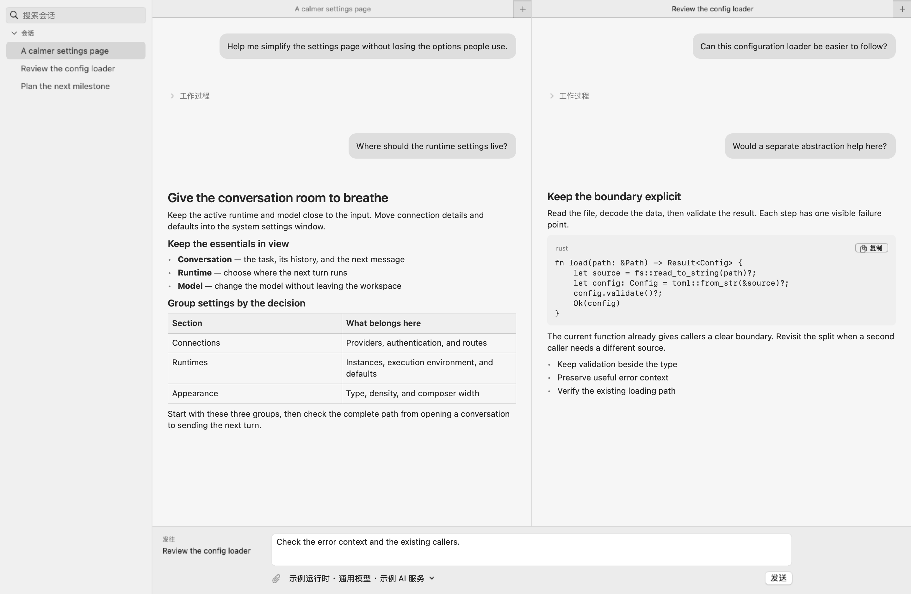
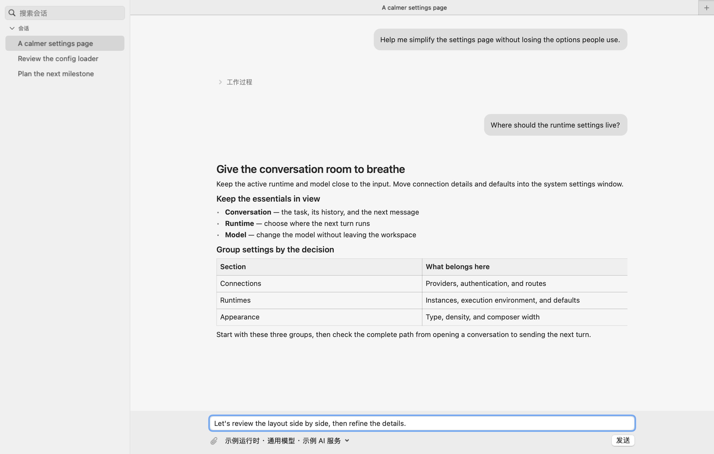

  <picture>
    <source media="(prefers-color-scheme: dark)" srcset="assets/brand/velune-large-dark.svg">
    
  </picture>

<h1 align="center">Velune</h1>

<strong>A native workspace for your coding agents.</strong>

English · <a href="README.zh-CN.md">简体中文</a>

  <a href="https://github.com/xiaoland/velune/releases">Beta downloads</a> ·
  <a href="docs/index.md">Documentation</a> ·
  <a href="https://github.com/xiaoland/velune/discussions">Discussions</a> ·
  <a href="https://github.com/xiaoland/velune/issues">Report an issue</a>

Bring Codex, Claude Code, Pi and ACP agents into one place. Browse their sessions, continue work across runtimes, choose providers and models, and control your desktop workspace from your phone.

Your installed harnesses execute tools and own their native histories. Velune provides the workspace, routing and coordination around them. Install your preferred harnesses separately and connect your own accounts or API providers.

*macOS workspace with synthetic conversations. The current interface is primarily in Chinese.*

Single-session view

## One workspace, several runtimes

- **Keep your sessions together.** Browse and organize conversations across agents, with execution status, unread markers, tabs, split views and separate windows.
- **Continue with another runtime.** Carry supported context into a new native session. Tool execution and approvals stay with the original session, and unsupported context produces an explicit error.
- **Choose your model connection.** Use a runtime's own provider or configure Velune-managed providers, models and routing. Subscription quotas remain specific to each provider.
- **Coordinate agents.** Follow native sub-agents and let independent sessions collaborate through Velune's tools.
- **Manage shared resources.** Organize instructions, skills, MCP services and sub-agent definitions through each runtime's supported capabilities.
- **Take control from your phone.** Connect a mobile client to a desktop host. That host keeps running the agents and holding their native histories.

The product documentation covers supported behavior and current boundaries. Most developer documentation is currently in Chinese. [Product guide](docs/prd/index.md)

## Platforms

| Platform | Role | First beta target |
| --- | --- | --- |
| macOS | Desktop host and remote client | macOS 15+, Apple Silicon / Intel |
| Windows | Desktop host and remote client | Source builds |
| Android | Remote client | Android 9+, arm64 signed APK |
| iPad | Remote client | Sign and install from the Mac app |
| iPhone | Remote client | Build from source |

The first public beta targets macOS and Android. macOS builds use ad-hoc signing and have no Apple notarization. Windows installer publication is deferred while dependency licensing is resolved. Follow the installation steps and available assets on the release page. [Releases](https://github.com/xiaoland/velune/releases)

Feature coverage differs by platform. [Windows coverage](app/windows/PARITY.md) · [Android scope](app/android/README.md)

## Get started

### On your desktop

1. Download a build for your operating system from [Releases](https://github.com/xiaoland/velune/releases), when available. For source builds, follow the [development guide](docs/development.md).
2. Install a supported harness, then add its runtime in Velune.
3. Open an existing session or create a new one. Use the runtime's native model connection or configure a provider in Velune.

Supported adapter versions, execution locations and model connections are documented in the runtime guide. [Agent runtimes](docs/prd/agent-runtimes.md)

### On your phone or iPad

Install the Android APK, keep a desktop host running, and pair with it from the device page. The host approves access and continues running your agents. See the remote-access guide for connection options and permissions. [Remote access](docs/prd/remote-access.md)

For iPad, the Mac app's **Settings → Devices → Install on iPad…** builds, signs and installs with your own Apple signing team in one action after setup. Prepare Xcode, the Rust toolchain and the matching Velune source version, then select your team and connected iPad. Device trust and Developer Mode must be enabled. [iPad installation](app/ios/README.md#从-mac-应用安装到-ipad)

## Build and contribute

Development targets `develop`. Pull requests promote release source to `main`, where version PRs and releases are managed. Start with the development and contribution guides. [Development](docs/development.md) · [Contributing](CONTRIBUTING.md)

For bugs, include the app version, operating system, runtime version and a small reproduction when possible. Remove credentials and private conversation data from diagnostics. Use private vulnerability reporting for security issues. [Report a bug](https://github.com/xiaoland/velune/issues/new/choose) · [Report a vulnerability](https://github.com/xiaoland/velune/security/advisories/new)

## Documentation

- [Product guide](docs/prd/index.md)
- [Architecture](docs/product-tdd/architecture.md)
- [Full documentation index](docs/index.md)

## License

Velune is licensed under AGPL-3.0-only. Desktop builds include RelayKit, based on New API. Bundled dependencies retain their respective licenses and notices. Binary releases include corresponding source and build materials. [License](LICENSE) · [RelayKit notices](app/mac/Licenses/RelayKit/NOTICE.md)
