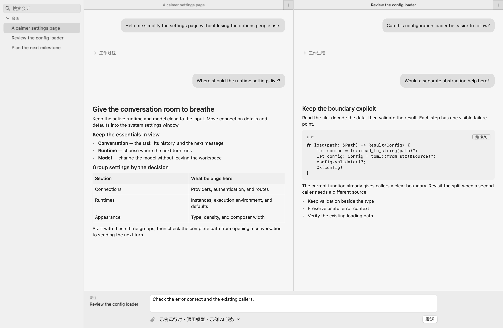
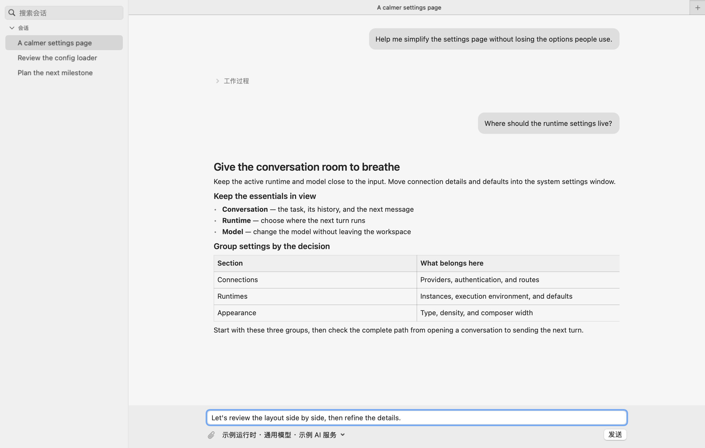

  <picture>
    <source media="(prefers-color-scheme: dark)" srcset="assets/brand/velune-large-dark.svg">
    
  </picture>

<h1 align="center">Velune</h1>

<strong>把 Coding Agents 放进同一个原生工作区。</strong>

<a href="README.md">English</a> · 简体中文

  <a href="https://github.com/xiaoland/velune/releases">Beta 下载</a> ·
  <a href="docs/index.md">文档</a> ·
  <a href="https://github.com/xiaoland/velune/discussions">讨论</a> ·
  <a href="https://github.com/xiaoland/velune/issues">问题反馈</a>

Velune 连接你安装的 Codex、Claude Code、Pi 和 ACP Agent，集中浏览会话、切换运行时继续工作、选择提供商与模型，并让多个 Agent 协作。桌面端负责执行，手机可以远程控制同一个工作区。

Harness 执行代码、调用工具并保存原生历史。Velune 提供围绕它们的工作区、路由和协调能力。运行时需要自行安装，账户与 API 凭据也由使用者配置。

*真实 macOS 视图，使用合成会话与模型信息。*

单会话界面

## 一个工作区，多个运行时

- **集中管理会话。** 查看不同运行时的消息、工作过程与状态，按项目或运行时整理，在 Tab、分屏和独立窗口间工作。
- **携带上下文接续。** 把支持的上下文交给另一运行时，在新原生会话中继续。原生工具操作与审批留在原会话，无法可靠迁移的内容会明确报错。
- **选择模型连接。** 沿用 Harness 的原生提供商，或配置 Velune 管理的提供商、模型与路由。不同订阅的额度仍分别管理。
- **让 Agent 协作。** 跟进原生子 Agent 的工作，也让独立会话通过 Velune 的协作工具相互联系。
- **按来源管理资源。** 整理指令、技能、MCP 服务与子 Agent 定义，按各运行时的能力管理和同步。
- **从手机控制工作区。** 从手机控制桌面上的会话，桌面继续持有运行任务和原生历史。

详细能力与当前边界见[产品文档](docs/prd/index.md)。

## 平台

| 平台 | 角色 | 获取方式 |
| --- | --- | --- |
| macOS | 桌面完整端，本机执行与远程控制 | [发布资产](https://github.com/xiaoland/velune/releases)／源码构建 |
| Windows | 桌面完整端，本机执行与远程控制 | [发布资产](https://github.com/xiaoland/velune/releases)／源码构建 |
| Android | 远程控制端 | [发布的签名 APK](https://github.com/xiaoland/velune/releases)／源码构建 |
| iPad / iPhone | 远程控制端 | 源码构建 |

首个公开 beta 正在准备。首批目标为 macOS 15+（Apple Silicon / Intel）、Windows x64 和 Android 9+ arm64。macOS 包采用 ad-hoc 签名且尚未公证，Windows 包尚无发布者签名，安装步骤见发布说明。可下载资产以发布页实际列出的内容为准。各端能力有差异，可先查看 [Windows 覆盖情况](app/windows/PARITY.md)和 [Android 范围](app/android/README.md)。

## 开始使用

### 桌面端

1. 从 [Releases](https://github.com/xiaoland/velune/releases) 获取已发布的对应平台构建。尚无适用资产时，按[开发说明](docs/development.md)从源码构建。
2. 安装所需的 Harness，在 Velune 中添加运行时。
3. 打开已有会话或新建会话，选择原生模型连接，或配置自己的提供商。

支持的 Adapter 版本、执行位置与模型连接见[运行时指南](docs/prd/agent-runtimes.md)。

### 手机端

安装 Android 构建，保持桌面完整端运行，再从设备页面配对并由桌面批准。手机端控制桌面会话，本机不运行 Coding Agent。连接和权限边界见[远程访问](docs/prd/remote-access.md)。

## 构建与贡献

开发默认使用 `develop`，`main` 通过 PR 接收发布相关变更。构建入口与各平台工具链见[开发说明](docs/development.md)和[贡献指南](CONTRIBUTING.md)。

报告问题时，提供应用版本、平台、相关运行时版本和尽可能小的复现。偶发问题也欢迎反馈。不公开原始会话、凭据或未经脱敏的诊断。安全漏洞通过[私下报告](https://github.com/xiaoland/velune/security/advisories/new)提交。

## 文档

- [产品定义](docs/prd/index.md)
- [架构说明](docs/product-tdd/architecture.md)
- [完整文档索引](docs/index.md)

## 许可

Velune 采用 AGPL-3.0-only。桌面端包含基于 New API 的 RelayKit，随包组件保留各自的许可证与声明。每次二进制发布同时提供对应源码和构建材料。[项目许可证](LICENSE) · [RelayKit 声明](app/mac/Licenses/RelayKit/NOTICE.md)
