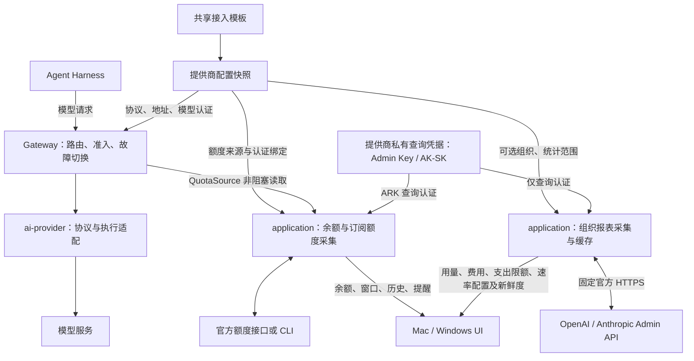

# 组织用量与账单采集

本页维护 application-api、application、bindings 与平台之间的组织报表契约。模型调用、认证与订阅额度见[AI 服务](ai-service.md)，产品规则见[组织用量与账单](../prd/ai-providers.md#组织用量与账单)。

## 组织用量与账单

调用配置与账户观测分别建模。共享目录只给出起始快照，协议、执行后端、请求 profile、模型认证、额度来源与可选账单配置各有职责；Moonshot API 与 Kimi Code、OpenAI Platform 与 Codex、Anthropic API 与 Claude Code 分别组合，不按品牌推断接入产品。

`application-api` 定义 `BillingConfiguration`、`BillingScope` 与带类型的报表；bindings／RPC 传递相同契约，平台只呈现结果。提供商私有查询凭据以 `QueryCredential` 区分 API key 与 AK/SK，不进入模型认证解析器或 Harness。`save_provider_billing` 单独原子持久化，保留／替换／清除秘密，不重建模型执行；`provider_billing` 立即返回状态并按需采集。模型认证 generation 变化暂停关联，不支持的目标清除配置。

账单采集只接受 HTTP、Native、API key 和精确官方 HTTPS 主机，查询目标另行固定，禁止重定向与隐式重试。OpenAI 读取 Usage Completions、Costs 与组织／Project Spend Limit；Anthropic 读取 beta Analytics Usage／Cost 与组织／Workspace Rate Limits。API key 范围只取对应报表，不伪装为拥有该范围的限额。外部响应在 HTTP 边界一次类型化；货币按币种累加，Anthropic 费用和 OpenAI 支出阈值由美分转为主币单位，token 细项按官方含义统计。

缓存身份由服务、组织、scope、查询凭据摘要和 UTC 月起点共同决定；同权限、同范围共享结果，平台不汇总重复组织总额。缓存仅在内存，TTL 15 分钟，手动刷新最短 30 秒，失败退避 60 秒；最多 4 项在途，不后台排队。单请求 12 秒、整个采集 45 秒，单页 2 MiB、最多 32 页／32,000 行；重复游标和中途失败拒绝该项总额，独立成功项可保留。删除、换绑、停机取消旧任务；即使删除后重建同一缓存身份，旧任务也不能回写。

报表带明确范围、UTC 统计区间、本地抓取和上游刷新时刻；Anthropic 整段统计按小时截断。部分失败逐项说明，全部失败保留旧报表并标为过期。报表不进入 `QuotaSnapshot`、准入、历史或提醒；配置限额不是余额，也不是此刻的剩余速率。接口语义依据 [OpenAI Costs](https://developers.openai.com/api/reference/resources/admin/subresources/organization/subresources/usage/methods/costs)、[Spend Limit](https://developers.openai.com/api/reference/resources/admin/subresources/organization/subresources/spend_limit/methods/retrieve)、[Anthropic Analytics](https://platform.claude.com/docs/en/manage-claude/usage-cost-analytics-api) 与 [Rate Limits](https://platform.claude.com/docs/en/manage-claude/rate-limits-api)。
