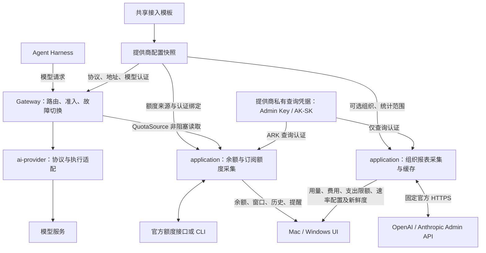

# AI 服务与 LLM Gateway

本页维护 AI 服务、提供商与 LLM 网关的职责划分与跨 unit 契约。产品行为见 [AI 提供商](../prd/ai-providers.md) 与 [模型路由](../prd/model-routing.md)；各 unit 的接口见 [gateway](../../packages/gateway/README.md)、[ai-provider](../../packages/ai-provider/README.md)、[application](../../packages/application/README.md) 与 [bindings](../../packages/bindings/README.md)。

## 职责

AI 服务是独立 lib，领域不限于 LLM；AI 服务与 Agent 运行时互相独立。gateway 是 LLM Gateway，是 AI 服务的一种应用模式：承担同协议原生透传、异协议 best-effort 转换、模型路由与 fail-over。Harness 是它的一类调用方，网关不是 Harness 专属；应用直接消费 AI 能力时不经过网关，AI 契约也不反向依赖 gateway。非 LLM 能力按具体用例扩展，不预建其他网关或空领域框架。

| unit | 负责 | 不承担 |
| --- | --- | --- |
| `ai` | 各操作的调用方与 provider 契约、原生内容封装、错误与生命周期语义 | HTTP、配置存储、Harness 规则；以 LLM 消息或 token 定义所有操作 |
| `ai-provider` | 对确定目标执行一次协议操作：认证应用、HTTP、原生响应与终态观察；请求范围的协议转换 | 路由选择、fail-over、隐藏重试 |
| `gateway` | 入口访问控制、模型解析、路由快照、请求约束、转换装配、候选选择、冷却与 fail-over、下游响应提交、用量采集 | 会话或工具执行、Harness 配置解释、读取应用目录 |
| `application` | 配置仓库与私有认证、认证生命周期、额度采集、跨域装配、导入与分析存储 | 再造协议 decoder，或要求 UI 补偿业务约束 |
| `agent-runtime` | Harness 原生配置、身份、模型能力与来源兼容设置的投影 | 网关路由权；把 Harness 参数变成 AI 服务的通用参数 |

领域包不读取全局环境、配置或认证文件，也不依赖 UniFFI。

## 提供商、模型与模板

提供商持有协议、服务地址与认证，拥有多个实际可调用的模型条目；模型条目保存稳定的 `recordKey`、精确的 `providerModelId`、显示字段、可选能力与逐请求合并进上游请求体的额外请求参数（`requestParameters`，冲突时覆盖适配器所设字段，上游不识别的字段以其自身错误失败；速度变体等服务档位由此声明为独立条目）。application 为新条目生成记录键，用户修改 API ID 时运行时选择仍引用原记录。网关派生 `velune/model/<recordKey>` 作为调用入口，不接受裸记录键作为 wire model；直接模型调用不需要另建路由。导入按来源提供商建立条目，不按名称合并跨提供商记录。

模板只复制名称、建议 API model ID、图标与可选能力，创建后成为独立快照；不复制认证、服务地址、记录键或 adapter 投影，调用链不保留模板身份。提供商模板（`provider_templates()`）是有序目录，每项含完整的能力组合、订阅或 API 种类、需要定位的本机命令与选择前披露，平台据此呈现“添加提供商”，不自行罗列组合。公开模型目录（models.dev）的适配归 application 的模板用例：显式拉取、保留来源提供商与模型 ID，能力只作建议，缺失或为零的规格保持未知；拉取不消费认证、不创建提供商，也不在后台更新已保存的快照。

未知能力保持未知，空推理等级列表表示明确不支持；不全局强制输出上限或统一 effort。缺少描述性规格不阻止原生调用，某个 Harness 必需的字段只在对应 adapter 的准备边界检查。

配置只接受 schema 11，切换版本前必须按[手动迁移约定](../development.md#破坏性变更与手动迁移)将已有配置转为当前格式。现有加载器仍会把未迁移的旧普通配置原子重置为空配置，不转换字段、不保留旧文件；这是当前实现行为，不能代替升级前的手动迁移。未来 schema、损坏 JSON 与当前版本的未知字段明确拒绝。原 Harness 文件、会话与已有平台秘密不在重置范围内。

## 认证

application 私有保存 API key 或认证来源定位，并向 gateway 注入中立的异步解析器；gateway 捕获目标并解析本次认证，不接收 Harness 类型、路径、来源 JSON 或 helper CLI；ai-provider 只消费本次解析出的短生命周期认证。

提供商字段与认证编辑一次原子提交。认证编辑区分保留、设置新值与清除，取消草稿或读取失败不清空既有凭据。私有文件以 0600 创建；列表、snapshot、Debug 与日志不含秘密，显式单条读取才返回。公开摘要只描述认证类型、配置状态、来源与可执行动作。

- **来源型 OAuth**：保留原来源的登录与刷新，由 adapter 在原存储锁内刷新，不复制 refresh credential。凭据 helper 在 Unix 上以独立进程组、在 Windows 上以 kill-on-close Job Object 运行，超时、取消与网关关闭时整树终止。
- **Codex 订阅**：在 Velune 中按账户独立登录与续期，复用 Codex OAuth 客户端身份与 ChatGPT Codex backend 约定，不是正式 SIWC；不导入 `auth.json`。多订阅轮换与 SIWC 的规则存在冲突，产品按用户要求在接入与路由处披露，不宣称供应商认可（[PRD](../prd/model-routing.md)）。
- **Claude 订阅**：经本机 Claude Code 执行后端接入，登录、秘密与续期归 Claude Code。独立登录使用专属 `CLAUDE_CONFIG_DIR`；也可沿用本机默认登录（不设置该变量）或某个 Claude Code 运行时实例的登录（使用其 `agentDir`），沿用时只经 `claude auth status` 检查状态。子进程保留真实系统 HOME 以访问 macOS Keychain。同一 Claude 账户只能绑定一个提供商。

## 能力组合与执行后端

提供商实例组合协议、执行后端、请求适配、认证来源与额度来源；有效组合在保存时校验，品牌只作为模板装配已支持的组合，不贯穿调度。一个订阅对应一个提供商实例，认证与额度观察关联同一绑定版本，换号使旧观察、执行会话与粘性失效。不提供任意脚本、任意凭据目标或通用插件框架。

application 持有认证生命周期、额度采集与跨 Runner 的执行后端句柄；gateway 持有候选选择、使用上限、冷却与 fail-over；ai-provider 处理原生协议、请求适配与实际执行。HTTP 认证恢复由具名恢复能力与稳定身份判定，不按品牌判断。

- **HTTP**：三种协议共用由 builder 构造的 HttpClient，禁用重定向与底层自动重试；代理、TLS 与超时仍可配置。ai-provider 输出中立的失败事实（认证、权限、配额耗尽、短暂限流等）并保留原 HTTP 状态。
- **Claude Code 后端**：只暴露调用方声明的工具，工具由调用方执行。执行会话按提供商绑定与显式会话身份隔离。尚未完成的工具交互绑定原提供商；取消、换绑或进程失败后，迟到的工具结果在候选选择前被拒绝，不启动新会话重做。外层 Harness 结束时显式结束该轮，正常完成的空闲进程可以复用。
- **Kimi Coding Plan**：HTTP、Messages、API Key、KimiCoding 请求适配与 KimiUsage 额度来源。账户由服务区域与 `user_id` 标识，经固定 `/me` 验证；同一区域内一个账户只能归属一个提供商。凭据版本取消旧任务并阻止旧结果回写，同账户换 Key 保留使用上限与冷却。
- **ARK Coding Plan**：额度认证（AK/SK）由提供商单独持有，只供 application 的固定控制面调用，不进入模型认证或 Harness。用户保存时确认它与当前模型认证属于同一套餐；这是用户确认的关联，不是自动核验，更换任一认证或目标都撤销关联。
- **账户额度来源**：`ApiAccount` 只接受以 API key 直连 DeepSeek、Moonshot、OpenRouter 精确官方主机的组合，查询发往同一主机，不跟随重定向、不重试，响应限 256 KiB。

额度窗口按实际返回解析，缺失保持未知，不补零、不猜套餐类型。具体窗口 ID 与字段见 [application](../../packages/application/README.md)。

## 组织用量与账单

调用配置与账户观测分别建模。共享目录只给出起始快照，协议、执行后端、请求 profile、模型认证、额度来源与可选账单配置各有职责；Moonshot API 与 Kimi Code、OpenAI Platform 与 Codex、Anthropic API 与 Claude Code 分别组合，不按品牌推断接入产品。

`application-api` 定义 `BillingConfiguration`、`BillingScope` 与带类型的报表；bindings／RPC 传递相同契约，平台只呈现结果。提供商私有查询凭据以 `QueryCredential` 区分 API key 与 AK/SK，不进入模型认证解析器或 Harness。`save_provider_billing` 单独原子持久化，保留／替换／清除秘密，不重建模型执行；`provider_billing` 立即返回状态并按需采集。模型认证 generation 变化暂停关联，不支持的目标清除配置。

账单采集只接受 HTTP、Native、API key 和精确官方 HTTPS 主机，查询目标另行固定，禁止重定向与隐式重试。OpenAI 读取 Usage Completions、Costs 与组织／Project Spend Limit；Anthropic 读取 beta Analytics Usage／Cost 与组织／Workspace Rate Limits。API key 范围只取对应报表，不伪装为拥有该范围的限额。外部响应在 HTTP 边界一次类型化；货币按币种累加，Anthropic 费用和 OpenAI 支出阈值由美分转为主币单位，token 细项按官方含义统计。

缓存身份由服务、组织、scope、查询凭据摘要和 UTC 月起点共同决定；同权限、同范围共享结果，平台不汇总重复组织总额。缓存仅在内存，TTL 15 分钟，手动刷新最短 30 秒，失败退避 60 秒；最多 4 项在途，不后台排队。单请求 12 秒、整个采集 45 秒，单页 2 MiB、最多 32 页／32,000 行；重复游标和中途失败拒绝该项总额，独立成功项可保留。删除、换绑、停机取消旧任务；即使删除后重建同一缓存身份，旧任务也不能回写。

报表带明确范围、UTC 统计区间、本地抓取和上游刷新时刻；Anthropic 整段统计按小时截断。部分失败逐项说明，全部失败保留旧报表并标为过期。报表不进入 `QuotaSnapshot`、准入、历史或提醒；配置限额不是余额，也不是此刻的剩余速率。接口语义依据 [OpenAI Costs](https://developers.openai.com/api/reference/resources/admin/subresources/organization/subresources/usage/methods/costs)、[Spend Limit](https://developers.openai.com/api/reference/resources/admin/subresources/organization/subresources/spend_limit/methods/retrieve)、[Anthropic Analytics](https://platform.claude.com/docs/en/manage-claude/usage-cost-analytics-api) 与 [Rate Limits](https://platform.claude.com/docs/en/manage-claude/rate-limits-api)。

## 路由与 fail-over

一个订阅对应一个提供商实例；application 拥有实例认证、额度采集与唯一快照，gateway 只经中立只读契约取得额度事实，并维护运行期共享的调度状态。提供商的使用上限独立于路由，直接调用同样受约束；路由拥有策略（Smart、Order、Rotate、Weight）、成员权重与粘性。会话身份由装配方显式提供，gateway 不依赖 Agent 运行时，也不根据正文猜测身份。额度窗口可带周期，Smart 按周期内尚余时间的比例衡量余量，只影响排序（[S55](../sources.md#s55)）。

路由捕获一次请求的配置版本、目标与认证引用，热编辑不改变正在执行的尝试。fail-over 由网关单独决策，provider 每次只执行一次尝试，不隐藏重试。候选只来自路由的显式成员；同协议是必要条件，不证明历史、文件、缓存、加密推理或服务端状态可交给另一账户（[S30](../sources.md#s30)）：

- 普通认证 401 停止；Codex 订阅允许同账户有界恢复一次，失效后可在提交前切换。
- 限流、配额耗尽（含结构化的 402 配额错误）、过载、5xx 与未获答复的连接或传输失败，在提交前可以切换下一成员；权限错误与其他请求错误停止。
- 聚合路由明确拒绝 `previous_response_id` 与 `conversation` 等上游状态引用，不静默删字段或改投其他账户。
- 成功响应头交付后不再切换，包括之后的 SSE 业务失败；不拼接两个流，也不缓存完整流来扩大切换窗口。
- Claude Code 子进程启动后，或向已有进程写入本次输入前，即进入不可自动重放状态；之后的退出、超时与解析错误不切换账户重做。CLI 故障不伪装成 HTTP 401。
- 取消结束本次调用，不触发 fail-over，也不声称撤销已发生的上游执行。

分类、冷却与观察的细节见 [gateway](../../packages/gateway/README.md)。

额度观测的附加信息由 application 计算，不进入 gateway：节奏（均匀消耗时此刻应已用的比例、按平均速度的预计用尽时间）与金额。每次成功观测按提供商写入 `$home/quota-history/` 的 JSONL，带认证绑定摘要；绑定改变时清空，未变化的值至多 10 分钟记一次，保留 30 天。观测由不满足变为满足使用上限、窗口用尽或账户不可用时产生提醒，核心保留最近 64 条，平台以序号游标轮询。

## 原生派发与观测

ChatCompletions、Responses 与 Messages 是同一原生派发操作的三种线协议：`velune_ai::NativeProvider` 以 `Protocol` 区分，共用请求、事件、失败与完成类型，每个 adapter 只服务构造时确定的一个协议。ai-provider 的 `NativeHttp` 按协议区分端点、认证头、输出上限字段与终态；Claude Code 本机后端实现同一契约。协议实现按协议组织，服务商名称、端点与模型标识是配置数据，不选择不同的通用执行路径。

gateway 按路由绑定写入精确的 `providerModelId`，其余请求字段保持原样；原生 JSON／SSE、HTTP 状态与安全响应头经同一保真边界。保真以非路由字段与响应事件的内容、顺序及含义为准，不要求 JSON 空白与成员顺序不变；同协议的未知扩展不丢弃。原生事件 sink 可等待，下游以容量为 1 的通道施加背压；取消关闭派发 Future。HTTP 入口使用 Axum。

- **Messages**：baseURL 追加 `/v1/messages`，同协议请求的版本由调用方的 `anthropic-version` 决定，异协议转换为 Messages 时使用 `2023-06-01`；API key 以 `x-api-key` 发送。缺少请求输出上限时使用目标模型配置的上限，不用硬编码常数。
- **注入地址**：Pi 与 DSH 的 Messages 注入使用网关 origin，OpenAI 协议使用 `/v1`。Codex 发给网关的协议是 Responses，上游可经转换使用其他协议。

协议终态与传输结束分别观察：原生 completed、incomplete、failed 与 finish reason 保留原义；HTTP 200、EOF 或客户端没有收到事件都不能单独证明成功或未执行。用量不足时保持未知，不补零。

网关观测记录关联 ID、协议、是否流式、目标在当前配置快照中的序号、HTTP 状态、阶段、耗时与结束归因，不记录正文、实际模型 ID、地址或认证引用。`gateway_response_ready` 只表示响应元数据已准备，不证明客户端已接收，也不是允许重放的提交闸门；request 的 `transport_completed` 表示转发通道结束，不代表模型业务成功。调用方断开与网关关闭分别记为 `downstream_closed` 与 `gateway_stopped`。日志装配见[架构](architecture.md#本地可观测性装配)与[开发说明](../development.md#本地诊断)。

## 运行时装配

application 优先选择运行时支持的同协议入口，否则选择运行时的原生入口并由网关转换；把所选提供商模型与中立的网关接入信息交给 adapter，执行侧只获得 loopback 入口与临时 token。额外的 wire 模型字符串以显式 alias 映射到稳定的模型记录，不按同名推断目标。会话的只读历史、resume、审批与取消都不进入网关。

提供商配置中的模型映射可以携带 `piProjection`，其类型与转换归 Pi adapter，不是通用模型能力；它保留来源 Pi 的兼容设置、采样参数与按推理级别的参数，使替换 provider 或 URL 不改变 SDK 编码。普通编辑保持协议、记录键与 API model ID 时保留投影，改变这些关联时清除。`ai`、`ai-provider`、公开模型 DTO、UniFFI 与平台 UI 都不携带 adapter 私有元数据。

## 运行时提供商导入

导入覆盖来源中的提供商、协议、端点、有效模型、能力参数与认证来源。application 在预览与应用时按所选运行时实例重新解析目录与执行配置，不接受调用方覆盖路径；来源的非秘密规范化快照变化使旧预览失效。预览不执行凭据命令、不刷新认证、不访问模型服务，也不返回秘密；无法由当前网关保持语义的配置显示原因。

| 来源 | 读取 | 导入为 |
| --- | --- | --- |
| Pi 1.0 | 有效模型配置与认证 | HTTP 提供商；静态 API key 复制到私有配置，OAuth 保留来源引用 |
| Codex | `config.toml` 的自定义 `model_providers` | HTTP 提供商，只复制字面 key |
| Claude Code | `settings.json` 的 `env` API 与登录 | HTTP 提供商，或沿用该运行时登录的 Claude CLI 提供商 |

`env_key` 与 `apiKeyHelper` 不解析，导入后在 Velune 填写；Codex 的 OpenAI／ChatGPT 登录与 `auth.json` 不读取。导入只支持默认本机执行的实例；DSH 与通用 ACP 没有导入。来源以 Bearer 发送 Messages key 时在预览中提示。

导入在当时形成快照，不做双向同步。重复项默认跳过，替换须明确选择：替换更新参数与认证、移除未选模型、保留仍被选中模型的记录键。应用前重新核对来源与目标配置，变化后要求重新预览；派发时核对保存的来源执行绑定，避免来源端点改变后把凭据发往另一个目标。导入不自动改变当前会话模型。

## 协议转换

异协议转换由 ai-provider 内部链接的 New API RelayKit Go 库完成（AGPLv3，见 [ai-provider](../../packages/ai-provider/README.md)），不引入 New API 管理服务。Rust 继续拥有 HTTP/SSE、认证、路由、取消、背压与原始计量；私有桥接封装请求范围的转换状态，不暴露给平台，也不建立常驻 Host 或 IPC。正常结束、失败与释放分别表达，取消与截断不调用成功收尾；同协议绕过转换。

网关在实际候选派发前，以已解析的提供商型号和该模型的输出上限准备转换；排序、fail-over 或认证失败后改选成员时重新准备，响应使用同一次派发的计划。失败且未交付 headers 的尝试不产生转换响应，最终错误仍由调度交付。

转换是 best-effort：无法完整表达的字段尽量保留可用内容、映射参数，并记录不含正文的降级诊断，不整次拒绝；不伪造历史、工具执行或上游成功。

- 文本增量立即交付。转换到 Messages 的工具参数须是合法 JSON object，因此在单个工具完成时交付有界累积的参数；Responses custom 工具在参数完成后解除 `{input:string}` 包装；无法解析的参数保留原始字符串并记录降级。OpenAI 两协议之间的普通 function 参数继续增量交付。
- 上游未知的 token 字段不补零。Messages 必需的数值字段无法获知时使用结构占位并记录 `usage / required_numeric_placeholder`，占位不进入计量。缺少上游 response ID 时生成请求范围的转换 ID，它不能用于上游查询或状态恢复。

## 用量与性能分析契约

计量来源是经过 Velune 网关的真实上游请求。ai-provider 从三种协议的原生 JSON／SSE 提取计量事实；gateway 在协议转换之前观察这些事实，关联请求与实际提供商和模型身份，交给调用方注入的统计接收器。统计与 tracing 独立，转换补造的占位值不进入统计；采集不改写同协议的原始响应。

application 持有分析存储、查询与记录生命周期，文件为配置根目录下的 `analytics.sqlite`。记录保留发生时的提供商身份、名称与实际 provider model ID，之后删除或改名不改变历史含义；它不是会话正文数据库。只统计启用后经过 Velune 的请求，不扫描运行时历史。采集与存储失败不影响模型业务结果，但要在本地诊断与分析读取状态中可辨认。

每项 token 数独立保留“已报告”或“未知”。OpenAI 的缓存读取属于输入子集、推理属于输出子集；Messages 的输入总量包含普通输入、缓存读取与缓存创建，缓存字段缺失时总量未知但保留已报告的普通输入。流式累计 usage 覆盖已知值，不逐事件累加。聚合同时返回报告覆盖数量：总量只合计输入与输出均已报告的请求，输入列与输出列各自合计已报告部分；缓存与推理细项不重复计入总量。依据为 [OpenAI usage 字段](https://developers.openai.com/api/reference/resources/chat/subresources/completions/methods/create)与 [Anthropic 缓存计量](https://platform.claude.com/docs/en/build-with-claude/prompt-caching)。

有效输出速率是已报告输出 token 除以从上游派发到业务终态的耗时，包含等待，不是纯生成速度；跨请求聚合用同一组有效请求的输出总量除以耗时总量。首输出延迟单列，只由流式的实际文本、推理或工具参数触发，headers、心跳与仅含 role 的事件不算；非流式不推测。失败或取消请求的已知用量仍保留。日期查询使用平台给出的本地日边界，存储为 UTC 瞬时。费用、订阅余额与输出质量不由这些指标推断。
