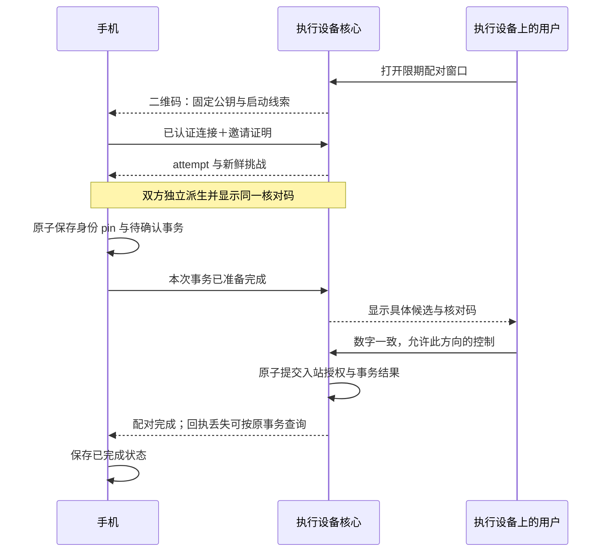

# 统一设备远控：配对、寻址与恢复

状态：2026-10-17 技术方案草案，尚未实现。产品约束归 [PRD](../prd/index.md#后续扩展分布式能力)，共享核心与包边界归 [架构入口](architecture.md#远控契约与唯一执行-owner2026-10-17)。本方案基于锁定的 iroh 1.3.0；源码核查和本机实验归 [研究记录](../../tasks/android-minimal/transport-research.md)。产品实现与真机验收仍暂停。

## 设备与状态归属

用户始终选择同一台设备。局域网地址、公网地址、relay 和查询这些地址的服务都属于连通信息，不产生另一类设备、业务接口或授权。Direct 既可能发生在局域网，也可能跨公网。默认使用 iroh 公共设施，连接设置可替换为兼容设施；正常添加设备不要求理解网络配置。

| 状态 | 权威与寿命 | 网络变化后的行为 |
| --- | --- | --- |
| 本设备私钥、公钥身份 | 应用私有设备存储 | 不因换网、换 relay 或端点重建而改变 |
| 已核验的目的设备身份 | 本机设备联系人记录 | 公钥固定；名称只是显示信息 |
| 本机授予对端的控制权 | 执行设备的入站授权记录 | 只有明确批准、撤销才能改变 |
| 会话、任务、审批 | 唯一 ApplicationService／Harness | 连接关闭不取消或重开业务 |
| 调用世代、去重账本、结果完成记账 | 与业务 owner 同寿命的远控服务 | 网络端点重建后仍能查询原请求 |
| 连接地址与来源、近期路径 | 可刷新缓存和连接状态 | 失败后重新发现；不作为身份依据 |
| QUIC 连接与监听资源 | 可替换的网络端点 | 路径迁移或受控重连 |

“记住这是我的 Mac”与“允许这个 Mac 控制本机”分别表达。手机扫码 Mac 时，手机保存 Mac 的身份，Mac 明确授权手机控制自己；不隐式授权反向控制。两台执行设备也沿用同一添加流程，每个方向由被控制设备确认，不引入账户或角色权限框架。

拟议 `RemoteAccessService` 继续放在 `remote` 包，通过 Handler 引用唯一业务 owner，不依赖 application 实现、不建立新进程或请求数据库。网络端点负责连接，服务持有有界账本及完成任务所需的异步 runtime。关闭远控接入应关闭网络和配对窗口，但不能销毁仍须完成的记账任务；宿主明确退出才结束整个服务寿命。controller-only 装配没有 Handler，同样持有设备身份、联系人及连接生命周期，不因此链接执行栈。

bindings 持有这份稳定服务，显式区分启停网络接入与关闭整个服务；界面“停止接入”不能再释放保存账本的 runtime。设施替换串行进行，同一身份保持一个主动发布的网络代际，避免两个独立 Endpoint 用同一密钥竞争发布位置。已有入站请求先按授权和账本接纳；接纳后由服务记账，不再依赖回执所在连接活着。

## 寻址与统一连接

联系人记录包含稳定公钥、显示名称、地址查找线索和有来源的最近地址缓存。执行世代属于本次经过认证的业务握手，不永久写成设备身份。首次二维码中的 IP、relay 也只是启动线索。

所有入口调用同一条连接流程：读取身份与线索，交由本地／公网 lookup 和已有地址提供候选，由 iroh 连接并校验目的公钥，再核验业务授权和调用世代，最后读取当前业务快照。GUI 不自行实现 LAN、WAN、relay 三套业务连接器，也不依次等待每种地址来源耗尽超时；保持 iroh 的候选查询与路径选择机制。

拟同时装配局域网地址查找与公共／自定义地址查找。mDNS 用于寻找已知身份的当前局域网地址，不自动建立信任，也不要求增加“附近设备”主流程。锁定版本的 Minimal 和 N0 都不含 mDNS，需单独适配。其作用是让公网设施不可用时，仍有局域网寻址渠道；同 Wi-Fi 的隔离策略、多播和平台路由仍可能阻断通信，不能仅靠配置宣称可达。

公共 Pkarr 默认只发布 relay 地址。当前 `Disabled + Pkarr` 并未实现“按 ID 找到直接 IP”；本方案不将私有局域网地址默认发布到公共 DNS 来弥补这个缺口。DNS、Pkarr 返回的是候选位置，最终身份由 QUIC 公钥认证确定；签名和 TTL 都不等于记录必然最新或地址必然可达。

relay 配置表达本设备的 home relay 候选和该服务的访问凭据，不是全局出站白名单。连接另一设备时，iroh 可能接入对端公布的 relay，即使它不在本设备候选列表。双方使用不同 relay 不要求两个服务器互联；需要认证的 relay 则要求连接方持有自己的有效访问资格，邀请和公开地址不得携带 bearer token。

受限 relay 的原生 Bearer 认证由应用私有配置按规范服务地址显式装配，不能拼进 URL、联系人或二维码，也不向 lookup 返回的任意 URL 附带默认 token；当前 URL-only SDK 尚未支持该项。若二维码的唯一可达启动路径依赖受限 relay，控制设备必须先取得有效访问资格，否则提示处理连接设置，不误报配对失败。不同运营方的准入／令牌签发不是统一 relay 协议自动解决的能力，本方案不为此增加账户系统。

因此，“自定义 relay”与“完全只使用自部署设施”不能混为一个保证。普通设置可保留默认地址查找并替换 relay；完整自部署需要两端的 relay、地址查找与访问资格都可用，不暗中回退到已被替换的公共预设。设置应能说明当前使用的设施，而不要求用户选择“局域网远控”或“公网远控”。

## 多路连接与自动优选

用户要求在公网使用中进入同一局域网后自动选路，离开后继续恢复。设备身份和业务连接意图保持不变；多条已发现、已验证或备用路径不产生多个业务 owner。这里的“最优”指在已发现且可达的路径中按明确策略自动选择，并在更好路径出现后升级，不承诺发现所有可能路径或全局最低延迟。当前目标不包含多链路带宽聚合。

| 层次 | 职责 | 不能据此推断 |
| --- | --- | --- |
| Android／Apple 平台和地址发现 | 将接口变化、局域网发现、公网 lookup 汇入同一设备；使相关网络上的 socket 真正可达 | 发现了 LAN 地址不等于已探测或可发送 |
| iroh 连接 | 验证路径、维护质量状态、选择实际发送路径与失效恢复 | Direct 不等于 LAN，备用路径存在不等于已走该路径 |
| Velune remote 服务 | 观察连接、关闭后自动重连，查询原请求并恢复业务快照 | 重连不等于重新提交写操作 |

已有 QUIC 连接仍可用时，优先在该连接内发现和切换路径。1.3.0 默认 selector 将 IP 置于 relay 之前，即使 relay RTT 更低；同档按平滑 RTT 排序，IPv6 有 3ms 偏置，改善至少 5ms 才切换。新增连接、路径建立或废弃触发选择，并非每次 RTT 更新都重选，也不直接综合丢包率或带宽。这些是锁定版本的实现细节，不是固定到产品契约中的常量。先保留原生策略，通过实际控制流的中断、延迟和丢包判断是否需要调整，不在 Kotlin 或 remote 中复制一套未经证实必要的评分器。

iroh 当前选择一条主数据路径，其他路径主要承担备用、探测与控制；客户端还可能关闭冗余 IP 路径。因此产品不要求 LAN 与公网 IP 始终同时保活，离开 LAN 后可能需要重新探测公网路径或回落 relay。原连接确实关闭后才进入同一设备的受控重连，不为遇到新地址而主动拆连接。

晚到地址是关键接线边界。mDNS 独立订阅不等于向既有 QUIC 连接注入候选：其 resolve 窗口只有 10 秒，窗口外新事件只到独立订阅；iroh 的已有 selected path 可抑制新 lookup，仍运行的 lookup 即使返回新地址，也只更新 peer 缓存。隔离实验中，晚到 lookup 地址进入缓存但在观察窗口内未触发该地址探测；同一地址经对端的 QNT 地址广告后，原连接打开了新路径并继续收发，见 [证据](../../tasks/android-minimal/transport-research.md)。因此，mDNS 首先补初次连接和重连寻址；活动连接升级须依靠已验证的地址变化／QNT 通路，不能把“接了 mDNS”写成已实现自动 LAN 升级。

原生地址变化与对端 QNT 地址增删会触发打洞；另外有 60 秒周期检查，但仅在没有 IP 路径或最小 IP RTT 大于 10ms 时尝试升级，不能把周期检查当及时发现 LAN 的保证。现有 Connection 没有公开的远端候选探测 API。若后续平台验收证实地址变化／QNT 链路遗漏，才评估上游适配；当前不建立第二条业务连接来规避接口边界。mDNS 0.6.0 的已有 peer 缓存更新亦有源码风险，采用前需固定依赖并单独判别。

实施时先验证两端本机地址变化是否及时进入原生地址广告与探测，包括已在公网连接时加入 LAN、LAN 地址移除与原生网络通知被采样去重的情形。只允许广告本机实际持有或已验证映射的地址，不把收到的对端 mDNS 地址冒充本机 external address。若新地址未进入活动连接，先定位发现与探测接线；若地址已知但 socket 无法使用对应 Android Network，修平台装配；只有已验证更好的路径仍长期未被选择时，才评估 selector 调整或上游接口适配。不会用频繁重连掩盖这些缺口。

路径观察至少提供连接内临时 path 标识、地址族、候选来源、selected 变化、RTT 和分段字节增量。来源说明地址如何获知，不证明实际流量所走接口；普通界面证据不足时只显示“直连”。诊断用受控地址／接口关联验证 LAN，并避免将原始地址放入常规日志。事件落后时重新读取完整路径快照。

验收在持续业务流中观察两个方向：公网连接加入同 LAN 后，新路径被发现、探测并在稳定更优时自动选中；离开 LAN 后，失效路径退出，其他直连或 relay 恢复。分别记录发现、探测、选中延迟和业务中断时长，验证同一任务继续、原请求可查询且未重复提交。补充接近 RTT 时的抖动、LAN 丢包、UDP 被阻断，以及非默认 Wi-Fi 与蜂窝并存；具体时限由锁定定时器和真机基线确定，不能以“最终连上”作为完整通过标准。

## 扫码与明确授权

二维码只开放一个有期限、受限的配对请求窗口。手机先从二维码固定执行设备公钥；执行设备从已完成握手的 `remote_id()` 取得手机公钥，不能使用请求正文自报的身份。名称、机型和谁先扫码都不是授权依据。

建议在两端显示相同的八位数字，由执行设备确认“数字一致，允许这台设备控制本机”。数字用于核对具体候选，不是短密码、可提交验证码或业务授权凭据。确认仅通过执行设备的本地可信管理入口执行；GUI 和 headless 消费相同的核心配对契约，无 GUI 不自动放行。

将手机保存放在执行端授权之前，避免正常客户端本地存储失败时，执行端已经留下无法继续的授权。执行端只允许确认已经声明准备完成的候选；此处确认动作就是提交点，不再增加“用户已允许、手机尚未保存”的阶段。执行端把 grant 和完成事务标识放在同一次原子写入中，成功后才允许业务。最终回执仍可能丢失，因此不宣称跨设备原子提交：手机以此前保存的 pin、事务 ID 和自身私钥重新连接查询。执行端未提交的候选在宿主重启后可明确失效；已提交授权的结果必须可查询，不要求清数据或再次消费邀请。

候选状态为 AwaitingReady、AwaitingApproval、Granted，以及未授权终态 Rejected／Expired／Disconnected。手机保存失败不发送 Ready；执行端保存失败不切到 Granted。取消只能取消未提交候选，不能把已提交授权当作已撤销；已提交结果根据当前 grant 查询，撤销后旧事务不能重建 grant。已核验但未完成的本地记录标为待确认，不能仅因有 pin 就显示“已授权”。

未授权的配对 RPC 只能开始本次请求、声明准备、查询自身事务或取消；不能操作业务、批准自己、列举其他候选。人工确认使用状态查询／事件，不让一个 RPC 在全局请求锁或并发许可内等待人操作。

### 核对绑定与中断

拟使用 [TLS 1.3 exporter](https://www.rfc-editor.org/rfc/rfc8446.html#section-7.5)，不增加另一套密钥交换。这里是采用标准原语的 Velune 确认协议，不声称原样实现 RFC 9266 或已经完成密码学审计。

草案固定专用 ASCII label `EXPORTER-Velune-Pairing-v2`，不含结尾 NUL。context 为固定 131 字节：`u16_be(2) || issuer_key[32] || controller_key[32] || invite_id[16] || attempt_id[16] || challenge[32] || direction_u8(1)`；方向 1 表示 controller 操作 issuer，公钥顺序同时固定角色。仅在完整握手和邀请校验后分配 attempt 与挑战，不使用 0-RTT。两端独立派生 32 字节，取前八字节的大端整数模 100000000，前补零显示八位；不得接受对端自报的显示码。

每个邀请最多产生五次不同挑战，计数原子且不会因取消、断线或换公钥而恢复。同一有效连接／attempt 重试返回原挑战，执行端随机数在候选准入之后生成，防止先批量建立 TLS 再挑选短码。本机隔离样例已验证双方一致、上下文隔离和新连接产生新绑定，见研究记录；八位显示仍可能碰撞，标准 exporter 的安全性质不代替产品协议复核，也不证明并发挑战计数已经实现正确。

未确认的挑战绑定原 QUIC/TLS 连接。路径迁移不改连接时保留核对码；连接确认关闭后，旧候选失效，不能再批准。重连若生成新挑战，必须计入同一邀请总预算；不能沿用 attempt 却在新 TLS 上无限重算 exporter。批准、断线和落盘按核心配对状态机串行裁决：结果只能是授权已提交并可查询，或候选失效未授权。已提交 grant 不随确认连接断开而撤销，也不能由旧完成请求重新激活已撤销的 grant。

### 二维码载荷

单码只携带用途与版本、执行端稳定公钥、invite ID、高熵 token、到期提示，以及少量直接地址、relay 和 lookup 启动线索。配对后再经已认证连接取得完整资料。建议编码后目标不超过 512 字节、硬上限 1024 字节，超限明确拒绝生成，不静默改为多码或要求手工处理 JSON；真实可扫性仍需现有手机验证。[QR 容量与密度](https://www.qrcode.com/en/about/version.html) 不等于实际扫码可靠性。

优先复用现有结构化序列化，不为二维码建立通用编码框架。二维码不包含调用世代、永久自动登录秘密或完整地址列表；不通过 HTTP 短链接解析，不执行扫码内容里的任意 URL／命令。邀请和相机帧不进入日志、通知预览或持久分析记录。辅助导入仍进入同一解析和确认流程，不构成第二种授权方式。

## 设施更换与恢复

更换 relay 候选可以热更新，但不能将 iroh 的 map 更新成功当成旧服务已断开。1.3.0 删除 relay 不立即结束旧 actor，替换 token 也不更新已有 actor；从 Disabled 启用还可能必须重建网络端点。因此，明确移除服务、切断旧凭据或改变 transport 装配时，采用可关闭旧资源的网络代际切换；不依赖未公开的空 relay map 行为。

“设置已保存”“网络代际已应用”“目的设备已连接”分别表示。新配置通过语法、协议和凭据格式校验后才进入切换；已应用表示资源与生效策略对应新代际、旧资源已退出，不表示所有公网设施或离线设备都可达。relay／公网 lookup 离线不能阻止仍可用的 LAN 路径。失败须说明未应用或具体连接设施不可用，不把保存成功当成连通成功，也不静默选择用户未配置的公共服务。允许短暂断线，恢复后继续使用原设备与请求账本。

严格退出由一个 owner 封闭旧代际新操作，取消该代际的观察／发现任务，完整等待一次 Endpoint.close，然后释放外部 publisher、查询流、旧客户端及 Endpoint 引用。内置 close 会清 lookup registry，但独立 publisher clone 可继续保活任务，UDP 最终释放也取决于全部引用；重复并发 close 的返回不作为完成屏障。该边界约束退出后的新请求，不撤回在途包或删除已发布记录。

更换 relay 而保留 lookup 时，向仍被对端使用的 lookup 发布新地址。更换整套地址发现设施则需要交接：先传播并保留新旧入口，再根据可观察的发布与已配对端确认收敛；不能把库的 `add` 返回或 DNS TTL 到期当成所有离线设备已更新。无需无限保留旧服务；若旧入口已全部撤除，离线设备又从未收到新入口，必须给原联系人带外更新连通信息。该更新保留已固定公钥，不自动授予权限或替换为另一设备。

| 事件 | 恢复方式 | 明确不做 |
| --- | --- | --- |
| 同一 QUIC 连接换路径 | 原连接继续，观察实际 selected path | 不重新配对、不重开业务 |
| QUIC 连接关闭 | 同一设备重新发现／认证；查询原未决 ID、刷新快照 | 不自动重发写操作 |
| 网络端点重建或关闭接入后重开 | 同一远控服务、调用世代与账本 | 不伪装成业务宿主重启 |
| 控制应用进程重启 | 恢复 pin、目的设备和待确认事务／请求 ID | 不要求恢复原 QUIC 会话 |
| 业务 owner／执行宿主重启 | 新调用世代；读取 Harness 真实状态 | 不承诺跨崩溃 exactly-once 或任务必然仍运行 |
| 结果已从有界缓存回收 | 明确结果不可得，刷新业务状态 | 不将过期结果当成允许重发 |
| 授权撤销、身份不符或协议不兼容 | 停止自动重连，呈现需处理的原因 | 不降级授权、不改接同名设备 |

后台只停止手机观察和相机，不取消执行设备已接纳任务。自动恢复以用户当前设备选择、前台状态和网络代际为同一连接意图；每个设备只维持一个恢复循环，使用有界退避，网络变化可唤醒重试。晚到的旧连接结果必须核对连接意图，不能覆盖新设备或新配置。

## 平台与实施边界

Android 已实现的装配为 Kotlin／Compose → UniFFI 生成的 Kotlin／JNA API → `libvelune_bindings.so` → Rust remote／iroh。构建仅启用 bindings 的 `remote` feature，不携带本地 application、Harness 或 AI 执行栈。平台初始化的少量 JNI 只提供 Android context，业务仍经 UniFFI 类型接口；新配对、恢复和路径策略继续归 Rust，Kotlin 提供界面、平台网络通知及相机生命周期。

Android 使用独立的联系人／待确认记录和入站授权概念，不能继续把完整 descriptor 当作永久设备记录。控制端只需恢复原请求 ID，不持久化消息正文来重发。扫码采用 CameraX 生命周期组件与 ZXing core 的离线解码路径，不强依赖 Google Play Services；候选版本及构建仍需实施时固定。相机仅在扫码界面持有；每帧关闭 ImageProxy、只处理最新帧，识别成功就停止分析。权限拒绝或不可用时，可用系统文件选择器选一张二维码图片，或显式粘贴邀请内容，全部进入同一解析和确认流程，不索取全盘媒体权限。

Android 默认网络回调不覆盖所有可用接口。无 Internet Wi-Fi 与蜂窝并存时，默认网络可能是蜂窝；不能用 `VALIDATED` 判定局域网可达性，也不能直接假定未绑定 socket 会走非默认 Wi-Fi。全进程绑定 Wi-Fi 又可能破坏公网 relay／lookup。先核实 iroh 的 socket 重绑与平台行为，再以受控真机实验决定是否需要逐 socket 适配，不在 UI 增加选网模式来掩盖问题。

锁定源码已确认重大变化会重绑 UDP socket 并 reset DNS；但 `network_change()` 只是提示，netwatch 采样相等会跳过。Android 适配没有 Network 身份／逐 socket 绑定，resolver 使用默认 Network 的 DNS。因此须把 Wi-Fi→蜂窝的恢复与两网同时可达分别验证。平台通知至少覆盖默认网络及链路属性变化；新增局域网监听和多播资源随前台需要管理，不以后台常驻、前台 service 或进程级强制绑网替代验证。

| 单元 | 拟议改动 |
| --- | --- |
| remote | 稳定远控服务与可替换端点；方向授权、限期配对事务、连接设置与 locator 刷新 |
| application／bindings | 复用唯一业务 owner；runtime 和账本寿命正确；具名配对观察／确认／查询 API |
| Mac | 统一接入开关与设备列表；二维码、数字核对、执行端确认；连接设置渐进披露 |
| Android | 离线扫码、持久待确认记录、单一自动恢复状态机；前后台和相机资源管理 |

协议与联系人 schema 按项目 hard-cutoff 更新，不维护两套远控协议；设备私钥不重建，也不从旧的双向 trust 记录推定新的方向授权。首个实施切片先完成可隔离验证的远控服务、账本和配对状态，再接两端界面，不再靠 UI 包装尚不存在的核心契约。

后续按四个有判据的切片实施：先分离远控服务寿命并观察端点重建后查询同一次合成写入；再实现方向授权及限期配对事务，验证确认／断线／落盘的竞争；然后统一 locator 和设施配置，验证严格移除、认证 relay、旧入口交接和 mDNS；最后接扫码和前台恢复，进行两端人工验收。不是先完成 UI 再补核心语义。产品实现与真机实验均须在本轮设计讨论后恢复。

实施前保留的技术判别项为 mDNS／相机依赖的实际编译与 Android 多网络路由；八位核对样例只验证 primitive 使用，不代替完整状态机。随后人工验收同网首次添加、异地重连、双方换网、Direct／Relay 路径变化和撤销。隔离实验不证明真实 NAT 成功率，二维码可显示也不证明现有手机可稳定扫描。
