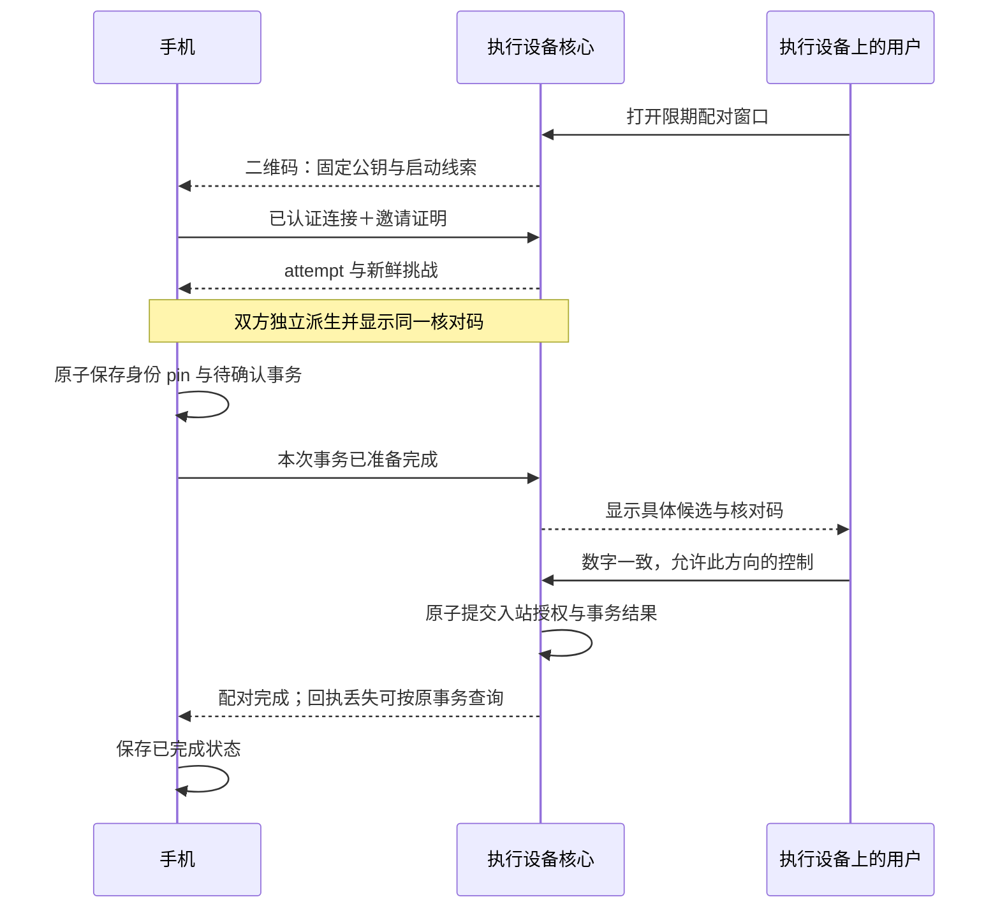

# 统一设备远控：配对、寻址与恢复

状态：2026-10-18 已收敛并获用户授权实施的工程方案，S1 同网源码与判别已收口，E2／E3 环境阻塞，当前进入 S2；本文件描述目标契约，不等同已实现或用户已验收。产品约束归 [PRD](../prd/index.md#后续扩展分布式能力)，共享核心与包边界归 [架构入口](architecture.md#远控契约与唯一执行-owner2026-10-17)。本方案基于锁定的 iroh 1.3.0；源码核查和本机实验归 [研究记录](../../tasks/android-minimal/transport-research.md)，执行次序归 [线性计划](../../tasks/android-minimal/plan.md)，通过条件归 [验收方案](../../tasks/android-minimal/acceptance.md)。实际实现与验收状态以 [任务](../../tasks/android-minimal/packet.md) 为准。

## 设备与状态归属

用户始终选择同一台设备。局域网地址、公网地址、relay 和查询这些地址的服务都属于连通信息，不产生另一类设备、业务接口或授权。Direct 既可能发生在局域网，也可能跨公网。默认使用 iroh 公共设施，连接设置可替换为兼容设施；正常添加设备不要求理解网络配置。

| 状态 | 权威与寿命 | 网络变化后的行为 |
| --- | --- | --- |
| 本设备私钥、公钥身份 | 应用私有设备存储 | 不因换网、换 relay 或端点重建而改变 |
| 已核验的目的设备身份 | 本机设备联系人记录 | 公钥固定；名称只是显示信息 |
| 本机授予对端的控制权 | 执行设备的入站授权记录 | 只有明确批准、撤销才能改变 |
| 会话、任务、审批 | 唯一 ApplicationService／Harness | 连接关闭不取消或重开业务 |
| 调用世代、去重账本、结果完成记账 | 与业务 owner 同寿命的远控服务 | 网络端点重建后仍能查询原请求 |
| 连接地址与来源、近期路径 | 可刷新缓存和连接状态 | 失败后重新发现；不作为身份依据 |
| QUIC 连接与监听资源 | 可替换的网络端点 | 路径迁移或受控重连 |

“记住这是我的 Mac”与“允许这个 Mac 控制本机”分别表达。手机扫码 Mac 时，手机保存 Mac 的身份，Mac 明确授权手机控制自己；不隐式授权反向控制。两台执行设备也沿用同一添加流程，每个方向由被控制设备确认，不引入账户或角色权限框架。

`RemoteAccessService` 继续放在 `remote` 包，通过 Handler 引用唯一业务 owner，不依赖 application 实现、不建立新进程或请求数据库。服务根保有有界账本、执行世代和已接纳任务；bindings 装配的同一份异步 runtime 与服务同寿命，不为每代 Endpoint 新建 runtime。已接纳任务只持服务状态与 Handler，完成记账不依赖旧网络对象。controller-only 装配没有 Handler，同样持有设备身份、联系人及连接生命周期，不因此链接执行栈。

bindings 持有这份稳定服务，显式区分停止本机被控入口、替换网络资源与关闭整个服务。“停止接入”关闭本机作为执行端的邀请、未确认候选及入站控制，不能误关本机正在控制其他设备的出站连接，也不能释放记账 runtime。没有出站需求时可以释放网络资源；宿主按已有退出规则真正结束时才关闭服务。设施替换串行进行，同一身份保持一个主动发布的网络代际，避免两个独立 Endpoint 用同一密钥竞争发布位置。

请求接纳、撤销和代际封闭共享一个串行裁决点。旧代际已读完但尚未进入账本的请求再次核对代际和授权；已进入账本的请求继续执行并完成记账。撤销先原子持久化，再拒绝后续接纳并关闭该方向的访问；已接纳的工作不因此取消，撤销设备也不能继续查询结果。其他已授权设备通过业务快照和真实审批继续操作，不冒用原设备的请求命名空间。真正更换业务 owner 才产生新的调用世代，网络启停不得伪造宿主重启。

## 共享接口与持久化

下表固定接口职责和可观察语义；导出使用 UniFFI 具名类型，最终语言拼写随生成器约束确定。平台不持有 Endpoint，也不直接组织配对网络消息。现有 `VeluneApplication` 保持业务代理入口，网络连接可在代理内部替换。

| 接口组 | 契约与消费者 |
| --- | --- |
| `open_service`、`set_control_ingress`、服务关闭 | 平台进程持有稳定服务；执行端附加现有唯一 Handler，控制端为 None。关闭服务只归应用最终生命周期，不作为界面断开操作 |
| `read_state`、`observe_state` | 返回带递增版本的完整快照；取消观察不关闭服务，事件落后重读快照。回调不在状态锁内调用平台代码 |
| `controller(peer_id)`、活动事实、`disconnect`／`resume` | 每个目的公钥一份恢复状态；窗口／视图共享，平台只报告选中、活动与网络事实。主动断开持久暂停，前台事件不能自动撤销用户选择 |
| `decode_offer`、`begin_pairing`、`cancel_pairing`、事务查询 | 有界离线解析后才建连；准备完成由 Rust 在原子保存后发送。重复相机帧或 Activity 重建不重复兑换邀请 |
| 本地邀请、批准／拒绝、`revoke_control` | 仅执行端本地可信管理入口可用，不进入远程业务 Command。取消与批准竞争时返回实际已提交状态，不伪造撤销 |
| `application_for_device(peer_id, view_id)`、未决请求观察／确认 | 保留完整业务 SDK；副作用命令统一经过写前记录。确认只结束本机跟踪，不取消远端任务、不删除服务端去重信息 |
| `apply_network`、连接资料更新 | 语法校验和持久化后串行应用网络代际；返回保存／应用状态。带外更新 locator 必须匹配已有固定公钥 |

Rust 是身份、联系人 pin、入站 grant、配对事务、未决请求、网络设置及主动暂停意图的唯一权威。复用 remote 内现有原子文件适配，平台显式传应用私有目录，不读取全局应用配置。Kotlin 只保存选中设备、阅读位置等 UI 偏好，删除 `DeviceStore` 对 descriptor 和 pending 的重复持久化；邀请、相机帧和显示码不进入 Bundle、SavedStateHandle 或备份。

副作用交付分类与修订冲突分类分开。`Command::changes_shared_state()` 用于业务修订，不能直接作为是否写 pending 的条件；在中立 API 中用穷尽匹配明确观察与副作用，覆盖上传、认证控制、运行时动作及配置／会话写入，新增命令必须明确交付分类。发送前固定目的公钥、调用世代、完整请求 ID 和执行上下文，原子保存 ID、操作种类、视图及必要定位元数据，成功后才发送。文件不保存消息、附件、秘密或可重放命令正文；容量满或写入失败时在发送前拒绝。

未决记录保留至平台处理结果并明确确认；确认落盘失败则保留。网络或控制进程恢复只查询原 ID；新进程可为新操作使用新 ClientSession，但旧记录的世代、client 和 sequence 不改。Unknown、ResultExpired、ServerRestarted 均不触发自动重发，先刷新业务快照；安全的观察请求可以重新发起。执行世代只采用认证 Hello 返回值，不使用联系人缓存中的 incarnation。

普通接入状态按 hard-cutoff 使用新 schema，识别旧 schema 后原子初始化当前空状态，不迁移旧双向 trust 或旧 pending，也不保留旧文件备份。独立身份文件继续原版本，损坏时阻止启动，不重新生成私钥。重置产生可确认且跨冷启保留的通知：“远控配置已更新，请重新添加设备。此前任务或结果未知的操作仍可能在执行，请检查会话；应用不会自动重发。”这项重置不作用于 Harness 文件、真实会话或平台秘密。

## 寻址与统一连接

联系人记录包含稳定公钥、显示名称、地址查找线索和有来源的最近地址缓存。执行世代属于本次经过认证的业务握手，不永久写成设备身份。首次二维码中的 IP、relay 也只是启动线索。

所有入口调用同一条连接流程：读取身份与线索，交由本地／公网 lookup 和已有地址提供候选，由 iroh 连接并校验目的公钥，再核验业务授权和调用世代，最后读取当前业务快照。GUI 不自行实现 LAN、WAN、relay 三套业务连接器，也不依次等待每种地址来源耗尽超时；保持 iroh 的候选查询与路径选择机制。

拟同时装配局域网地址查找与公共／自定义地址查找。mDNS 用于寻找已知身份的当前局域网地址，不自动建立信任，也不要求增加“附近设备”主流程。锁定版本的 Minimal 和 N0 都不含 mDNS，需单独适配。其作用是让公网设施不可用时，仍有局域网寻址渠道；同 Wi-Fi 的隔离策略、多播和平台路由仍可能阻断通信，不能仅靠配置宣称可达。

公共 Pkarr 默认只发布 relay 地址。当前 `Disabled + Pkarr` 并未实现“按 ID 找到直接 IP”；本方案不将私有局域网地址默认发布到公共 DNS 来弥补这个缺口。DNS、Pkarr 返回的是候选位置，最终身份由 QUIC 公钥认证确定；签名和 TTL 都不等于记录必然最新或地址必然可达。

relay 配置表达本设备的 home relay 候选和该服务的访问凭据，不是全局出站白名单。连接另一设备时，iroh 可能接入对端公布的 relay，即使它不在本设备候选列表。双方使用不同 relay 不要求两个服务器互联；需要认证的 relay 则要求连接方持有自己的有效访问资格，邀请和公开地址不得携带 bearer token。

受限 relay 的原生 Bearer 认证由应用私有配置按规范服务地址显式装配，不能拼进 URL、联系人或二维码，也不向 lookup 返回的任意 URL 附带默认 token；当前 URL-only SDK 尚未支持该项。若二维码的唯一可达启动路径依赖受限 relay，控制设备必须先取得有效访问资格，否则提示处理连接设置，不误报配对失败。不同运营方的准入／令牌签发不是统一 relay 协议自动解决的能力，本方案不为此增加账户系统。

因此，“自定义 relay”与“完全只使用自部署设施”不能混为一个保证。普通设置可保留默认地址查找并替换 relay；完整自部署需要两端的 relay、地址查找与访问资格都可用，不暗中回退到已被替换的公共预设。设置应能说明当前使用的设施，而不要求用户选择“局域网远控”或“公网远控”。

## 多路连接与自动优选

用户要求在公网使用中进入同一局域网后自动选路，离开后继续恢复。设备身份和业务连接意图保持不变；多条已发现、已验证或备用路径不产生多个业务 owner。这里的“最优”指在已发现且可达的路径中按明确策略自动选择，并在更好路径出现后升级，不承诺发现所有可能路径或全局最低延迟。当前目标不包含多链路带宽聚合。

| 层次 | 职责 | 不能据此推断 |
| --- | --- | --- |
| Android／Apple 平台和地址发现 | 将接口变化、局域网发现、公网 lookup 汇入同一设备；使相关网络上的 socket 真正可达 | 发现了 LAN 地址不等于已探测或可发送 |
| iroh 连接 | 验证路径、维护质量状态、选择实际发送路径与失效恢复 | Direct 不等于 LAN，备用路径存在不等于已走该路径 |
| Velune remote 服务 | 观察连接、关闭后自动重连，查询原请求并恢复业务快照 | 重连不等于重新提交写操作 |

首版工程策略确定为可用直连优先、同档按原生 RTT／迟滞选择、失效时回落 relay。已有 QUIC 连接仍可用时，优先在该连接内发现和切换路径。1.3.0 默认 selector 将 IP 置于 relay 之前，即使 relay RTT 更低；同档按平滑 RTT 排序，IPv6 有 3ms 偏置，改善至少 5ms 才切换。新增连接、路径建立或废弃触发选择，并非每次 RTT 更新都重选，也不直接综合丢包率或带宽。这些数字是锁定版本的实现细节，不复制成产品配置。若直连长期存活却造成不可接受的控制延迟，作为策略缺口处理，不能因原生算法符合预期就忽略体验失败。

iroh 当前选择一条主数据路径，其他路径主要承担备用、探测与控制；客户端还可能关闭冗余 IP 路径。因此产品不要求 LAN 与公网 IP 始终同时保活，离开 LAN 后可能需要重新探测公网路径或回落 relay。原连接确实关闭后才进入同一设备的受控重连，不为遇到新地址而主动拆连接。

晚到地址是关键接线边界。mDNS 独立订阅不等于向既有 QUIC 连接注入候选：其 resolve 窗口只有 10 秒，窗口外新事件只到独立订阅；iroh 的已有 selected path 可抑制新 lookup，仍运行的 lookup 即使返回新地址，也只更新 peer 缓存。隔离实验中，晚到 lookup 地址进入缓存但在观察窗口内未触发该地址探测；同一地址经对端的 QNT 地址广告后，原连接打开了新路径并继续收发，见 [证据](../../tasks/android-minimal/transport-research.md)。因此，mDNS 首先补初次连接和重连寻址；活动连接升级须依靠已验证的地址变化／QNT 通路，不能把“接了 mDNS”写成已实现自动 LAN 升级。

原生地址变化与对端 QNT 地址增删会触发打洞；另外有 60 秒周期检查，但仅在没有 IP 路径或最小 IP RTT 大于 10ms 时尝试升级，不能把周期检查当及时发现 LAN 的保证。现有 Connection 没有公开的远端候选探测 API。若后续平台验收证实地址变化／QNT 链路遗漏，才评估上游适配；当前不建立第二条业务连接来规避接口边界。mDNS 的缓存更新另以固定依赖和独立实验核对，不能代替活动连接探测。

实施时先验证两端本机地址变化是否及时进入原生地址广告与探测，包括已在公网连接时加入 LAN、LAN 地址移除与原生网络通知被采样去重的情形。只允许广告本机实际持有或已验证映射的地址，不把收到的对端 mDNS 地址冒充本机 external address。若新地址未进入活动连接，先定位发现与探测接线；若地址已知但 socket 无法使用对应 Android Network，修平台装配；只有已验证更好的路径仍长期未被选择时，才评估 selector 调整或上游接口适配。不会用频繁重连掩盖这些缺口。

路径观察至少提供进程内连接编号、连接内临时 path 标识、地址族、selected 变化、RTT 和分段字节增量。候选来源只报告实际掌握的事实，原生接口未提供时为 Unknown，不根据私网地址猜测 mDNS。来源不证明实际流量所走接口；普通界面证据不足时只显示“直连”。诊断用受控地址／接口关联验证 LAN，并避免将原始地址放入常规日志。事件落后时保留原生漏事件数并重新读取完整路径快照；快照不能补回遗漏的事件历史。

验收在持续业务流中观察两个方向：公网连接加入同 LAN 后，新路径被发现、探测并在稳定更优时自动选中；离开 LAN 后，失效路径退出，其他直连或 relay 恢复。工程预算在首次实验前固定为：符合原生优选条件的 LAN 升级 10 秒、已有已验证备用路径的故障恢复 15 秒、重新拨号／前台恢复 30 秒；计时起止和环境条件以验收方案为准。这是待验证工程标准，不是已达到的能力或生产 SLA。超时即失败，延长诊断观察不能补签通过。补充接近 RTT 时的抖动、LAN 丢包、UDP 被阻断，以及非默认 Wi-Fi 与蜂窝并存。

## 扫码与明确授权

二维码只开放一个有期限、受限的配对请求窗口。手机先从二维码固定执行设备公钥；执行设备从已完成握手的 `remote_id()` 取得手机公钥，不能使用请求正文自报的身份。名称、机型和谁先扫码都不是授权依据。

两端显示相同的八位数字，由执行设备确认“数字一致，允许这台设备控制本机”。数字用于核对具体候选，不是短密码、可提交验证码或业务授权凭据。确认仅通过执行设备的本地可信管理入口执行；GUI 和 headless 消费相同的核心配对契约，无 GUI 不自动放行。本切片提供 headless 可消费的本地核心 API 与隔离驱动，不新增常驻 daemon 或独立 headless 产品。

将手机保存放在执行端授权之前，避免正常客户端本地存储失败时，执行端已经留下无法继续的授权。执行端只允许确认已经声明准备完成的候选；此处确认动作就是提交点，不再增加“用户已允许、手机尚未保存”的阶段。执行端把 grant 和完成事务标识放在同一次原子写入中，成功后才允许业务。最终回执仍可能丢失，因此不宣称跨设备原子提交：手机以此前保存的 pin、事务 ID 和自身私钥重新连接查询。执行端未提交的候选在宿主重启后可明确失效；已提交授权的结果必须可查询，不要求清数据或再次消费邀请。

候选状态为 AwaitingReady、AwaitingApproval、Granted，以及未授权终态 Rejected／Expired／Disconnected。手机保存失败不发送 Ready；执行端保存失败不切到 Granted。取消只能取消未提交候选，不能把已提交授权当作已撤销；已提交结果根据当前 grant 查询，撤销后旧事务不能重建 grant。已核验但未完成的本地记录标为待确认，不能仅因有 pin 就显示“已授权”。

每台执行端同时开放一个配对窗口，默认五分钟、最长十分钟；重新生成关闭旧窗口和未提交候选，保留已经提交的 grant。每个窗口最多五次挑战，候选期限不超过窗口期限。批准记录将当前 grant 与 completed attempt ID 一起原子保存，重复查询只在当前 grant 仍匹配该 peer／attempt 时返回 Granted；旧事务已被撤销、取代或不可查时返回明确的未授权／不可得状态，不能据旧回执重建权限。其余候选在成功提交后失效，邀请随提交消费；未提交状态不承诺跨宿主重启保留。

未授权的配对 RPC 只能开始本次请求、声明准备、查询自身事务或取消；不能操作业务、批准自己、列举其他候选。人工确认使用状态查询／事件，不让一个 RPC 在全局请求锁或并发许可内等待人操作。

### 核对绑定与中断

使用 [TLS 1.3 exporter](https://www.rfc-editor.org/rfc/rfc8446.html#section-7.5)，不增加另一套密钥交换。这里是采用标准原语的 Velune 确认协议，不声称原样实现 RFC 9266 或已经完成密码学审计。

固定专用 ASCII label `EXPORTER-Velune-Pairing-v2`，不含结尾 NUL。context 为固定 131 字节：`u16_be(2) || issuer_key[32] || controller_key[32] || invite_id[16] || attempt_id[16] || challenge[32] || direction_u8(1)`；方向 1 表示 controller 操作 issuer，公钥顺序同时固定角色。仅在完整握手和邀请校验后分配 attempt 与挑战，不使用 0-RTT。两端独立派生 32 字节，取前八字节的大端整数模 100000000，前补零显示八位；不得接受对端自报的显示码。

每个邀请最多产生五次不同挑战，计数原子且不会因取消、断线或换公钥而恢复。同一有效连接／attempt 重试返回原挑战，执行端随机数在候选准入之后生成，防止先批量建立 TLS 再挑选短码。本机隔离样例已验证双方一致、上下文隔离和新连接产生新绑定，见研究记录；八位显示仍可能碰撞，标准 exporter 的安全性质不代替产品协议复核，也不证明并发挑战计数已经实现正确。

未确认的挑战绑定原 QUIC/TLS 连接。路径迁移不改连接时保留核对码；连接确认关闭后，旧候选失效，不能再批准。重连若生成新挑战，必须计入同一邀请总预算；不能沿用 attempt 却在新 TLS 上无限重算 exporter。批准、断线和落盘按核心配对状态机串行裁决：结果只能是授权已提交并可查询，或候选失效未授权。已提交 grant 不随确认连接断开而撤销，也不能由旧完成请求重新激活已撤销的 grant。

### 二维码载荷

单码只携带用途与版本、执行端稳定公钥、invite ID、32 字节随机 token、到期提示，以及少量直接地址、relay 和 lookup 启动线索。配对后再经已认证连接取得完整资料。编码后目标不超过 512 字节、硬上限 1024 字节，超限明确拒绝生成，不静默改为多码或要求手工处理 JSON；真实可扫性仍需现有手机验证。[QR 容量与密度](https://www.qrcode.com/en/about/version.html) 不等于实际扫码可靠性。

优先复用现有结构化序列化，不为二维码建立通用编码框架。二维码不包含调用世代、永久自动登录秘密或完整地址列表；不通过 HTTP 短链接解析，不执行扫码内容里的任意 URL／命令。邀请和相机帧不进入日志、通知预览或持久分析记录。辅助导入仍进入同一解析和确认流程，不构成第二种授权方式。

## 设施更换与恢复

更换 relay 候选可以热更新，但不能将 iroh 的 map 更新成功当成旧服务已断开。1.3.0 删除 relay 不立即结束旧 actor，替换 token 也不更新已有 actor；从 Disabled 启用还可能必须重建网络端点。因此，明确移除服务、切断旧凭据或改变 transport 装配时，采用可关闭旧资源的网络代际切换；不依赖未公开的空 relay map 行为。

“设置已保存”“网络代际已应用”“目的设备已连接”分别表示。新配置通过语法、协议和凭据格式校验后才进入切换；已应用表示资源与生效策略对应新代际、旧资源已退出，不表示所有公网设施或离线设备都可达。relay／公网 lookup 离线不能阻止仍可用的 LAN 路径。失败须说明未应用或具体连接设施不可用，不把保存成功当成连通成功，也不静默选择用户未配置的公共服务。允许短暂断线，恢复后继续使用原设备与请求账本。

旧代际关闭后若新装配失败，保留已保存的目标配置并显示未应用及原因，不自动重新启用已明确移除的旧设施。配置修正或显式重试沿同一串行入口进行，设备身份、授权和未决请求保持。

严格退出由一个 owner 封闭旧代际新操作，取消该代际的观察／发现任务，完整等待一次 Endpoint.close，然后释放外部 publisher、查询流、旧客户端及 Endpoint 引用。内置 close 会清 lookup registry，但独立 publisher clone 可继续保活任务，UDP 最终释放也取决于全部引用；重复并发 close 的返回不作为完成屏障。该边界约束退出后的新请求，不撤回在途包或删除已发布记录。

更换 relay 而保留 lookup 时，向仍被对端使用的 lookup 发布新地址。更换整套地址发现设施则需要交接：先传播并保留新旧入口，再根据可观察的发布与已配对端确认收敛；不能把库的 `add` 返回或 DNS TTL 到期当成所有离线设备已更新。无需无限保留旧服务；若旧入口已全部撤除，离线设备又从未收到新入口，必须给原联系人带外更新连通信息。该更新保留已固定公钥，不自动授予权限或替换为另一设备。

| 事件 | 恢复方式 | 明确不做 |
| --- | --- | --- |
| 同一 QUIC 连接换路径 | 原连接继续，观察实际 selected path | 不重新配对、不重开业务 |
| QUIC 连接关闭 | 同一设备重新发现／认证；查询原未决 ID、刷新快照 | 不自动重发写操作 |
| 网络端点重建或关闭接入后重开 | 同一远控服务、调用世代与账本 | 不伪装成业务宿主重启 |
| 控制应用进程重启 | 恢复 pin、目的设备和待确认事务／请求 ID | 不要求恢复原 QUIC 会话 |
| 业务 owner／执行宿主重启 | 新调用世代；读取 Harness 真实状态 | 不承诺跨崩溃 exactly-once 或任务必然仍运行 |
| 结果已从有界缓存回收 | 明确结果不可得，刷新业务状态 | 不将过期结果当成允许重发 |
| 授权撤销、身份不符或协议不兼容 | 停止自动重连，呈现需处理的原因 | 不降级授权、不改接同名设备 |

后台只停止手机观察和相机，不取消执行设备已接纳任务。自动恢复以用户当前设备选择、前台状态和网络代际为同一连接意图；每个设备只维持一个恢复循环，使用有界退避，网络变化可唤醒重试。晚到的旧连接结果必须核对连接意图，不能覆盖新设备或新配置。

恢复循环归 Rust Controller；Kotlin 的快照观察失败不得自行拨号。瞬时故障采用从 1 秒增长至最多 15 秒、带有限抖动的退避，新的网络代际或前台恢复可唤醒同一个任务；重复事实不建立新任务。连接状态为 Disconnected（含用户暂停）、Suspended、Discovering、Connecting、Connected、Recovering、Blocked；信任与配对状态另行投影，离线时“上次确认授权”不等于本次已获授权。撤销、身份不符、协议不兼容进入 Blocked，不能靠无期限重试绕过。

## 平台与实施边界

Android 已实现的装配为 Kotlin／Compose → UniFFI 生成的 Kotlin／JNA API → `libvelune_bindings.so` → Rust remote／iroh。构建仅启用 bindings 的 `remote` feature，不携带本地 application、Harness 或 AI 执行栈。平台初始化的少量 JNI 只提供 Android context，业务仍经 UniFFI 类型接口；新配对、恢复和路径策略继续归 Rust，Kotlin 提供界面、平台网络通知及相机生命周期。

Android 使用独立的联系人／待确认记录和入站授权概念，不能继续把完整 descriptor 当作永久设备记录。控制端只需恢复原请求 ID，不持久化消息正文来重发。扫码采用 CameraX 生命周期组件与 ZXing core 的离线解码路径，不强依赖 Google Play Services；候选版本及构建仍需实施时固定。相机仅在扫码界面持有；每帧关闭 ImageProxy、只处理最新帧，识别成功就停止分析。权限拒绝或不可用时，可用系统文件选择器选一张二维码图片，或显式粘贴邀请内容，全部进入同一解析和确认流程，不索取全盘媒体权限。

Android 默认网络回调不覆盖所有可用接口。无 Internet Wi-Fi 与蜂窝并存时，默认网络可能是蜂窝；不能用 `VALIDATED` 判定局域网可达性，也不能直接假定未绑定 socket 会走非默认 Wi-Fi。全进程绑定 Wi-Fi 又可能破坏公网 relay／lookup。先核实 iroh 的 socket 重绑与平台行为，再以受控真机实验决定是否需要逐 socket 适配，不在 UI 增加选网模式来掩盖问题。

锁定源码已确认重大变化会重绑 UDP socket 并 reset DNS；但 `network_change()` 只是提示，netwatch 采样相等会跳过。Android 适配没有 Network 身份／逐 socket 绑定，resolver 使用默认 Network 的 DNS。因此须把 Wi-Fi→蜂窝的恢复与两网同时可达分别验证。平台通知至少覆盖默认网络及链路属性变化；新增局域网监听和多播资源随前台需要管理，不以后台常驻、前台 service 或进程级强制绑网替代验证。

第一项实施判别先保留现有传输与 selector，仅补网络事件和路径观察，验证平台地址变化／QNT。随后分别比较非默认 Wi-Fi 上普通 UDP 与显式 Network 绑定：普通可达则不增加适配；只有显式绑定可达时，才在 UDP 创建及每次 rebind 贯通 Network 生命周期。iroh 1.3 没有内置 UDP FD 绑定回调，该分支需要经固定版本验证的窄补丁或上游扩展，不采用不稳定 custom transport 另造 IP 栈。两种 UDP 都不可达时先修实验环境，不推断库缺陷。

mDNS 单独验证初连、地址更新和过期。S1 选择官方修复提交 `6f103e7a92ddbd2007383527ab5024c983e3c1c6`（包版本 0.6.0），覆盖插入缓存；host／Android 编译和独立缓存更新／过期实验已完成。随后手机同公钥／同广告正对照确认，默认多播路由下发现失败，增加显式 LAN 接口后按 ID 发现并完成 marker。该事实触发有界依赖调整：只 vendor 此官方 crate 并维护接口装配的最小本地修改，保留来源、双许可、wire format、缓存修复和默认发现周期，不引入整个上游 workspace。源码证据、对照条件与后续缺口归研究记录和验收记录。

发现接口依据本机实际 LAN 链路选择，覆盖非默认 Wi-Fi／以太网，不由默认路由、Internet 验证标记、RFC1918 范围或 Endpoint 对外候选推导。复用平台网络事实与现有 netwatch，只补缺失的接口属性。有效接口集合变化只替换内部 discovery；Endpoint、业务连接、lookup 注册及外部订阅保持，空集合停用该发现来源，不能退回未经选择的默认多播出口。旧实例 callback 按发现代际隔离，缓存失效和订阅仍需明确处理。swarm 动态移除接口与 DropGuard 的返回均不能替代实际资源退出证据，补丁和两平台生命周期仍按 S1 验收；IPv4 通过不推导 IPv6 通过。

非空集合指定尝试装配的 LAN 发送接口，保留 swarm 的 wildcard 默认接收及全部显式 sender 创建失败时的默认发送回落，不保证报文仅通过这些接口。创建失败的既有诊断保持可见；不为流量隔离扩大到第二份 swarm 补丁。接口配置代际已更新只说明处理了该配置，不能显示为 LAN 已就绪；实际发现、marker 和路径证据分别验证可达性。

subscribe→MemoryLookup 不能替代遗漏的更新或活动连接探测。当前证据支持修正同协议的接口装配，不支持未经协议核对换成 Android NSD 或另造 discovery。真正跨网和非默认 Wi-Fi／蜂窝路由继续独立判别。

| 单元 | 拟议改动 |
| --- | --- |
| remote | 稳定远控服务与可替换端点；方向授权、限期配对事务、连接设置与 locator 刷新 |
| application／bindings | 复用唯一业务 owner；runtime 和账本寿命正确；具名配对观察／确认／查询 API |
| Mac | 统一接入开关与设备列表；二维码、数字核对、执行端确认；连接设置渐进披露 |
| Android | 离线扫码、持久待确认记录、单一自动恢复状态机；前后台和相机资源管理 |

协议、ALPN、邀请及普通存储 schema 一次切到 v2，不维护旧远控协议；设备私钥格式保持不变。UniFFI 改动与 Mac／Android 直接调用方在同一编译切片完成，保留生成器已验证的 shutdown／ListConfiguration 命名及 Android 初始化，不手改生成代码。每个切片都形成两端可编译检查点，切片完成不表示已完成整项产品验收。

实施按 [唯一线性计划](../../tasks/android-minimal/plan.md) 推进：先有界验证平台传输，再稳定服务与账本，随后同切 v2 契约、完成寻址与恢复、接完整扫码界面，最后按既定矩阵验收。Android socket 接入点、QNT 通知遗漏、mDNS 修复方式与相机表现是计划中的判别分支，不再泛化为重新选择传输协议。出现需重造传输栈或降低产品目标的证据才重开架构决定；尚未实现的状态机和真实 NAT／移动网络表现不因方案收敛而视为通过。
