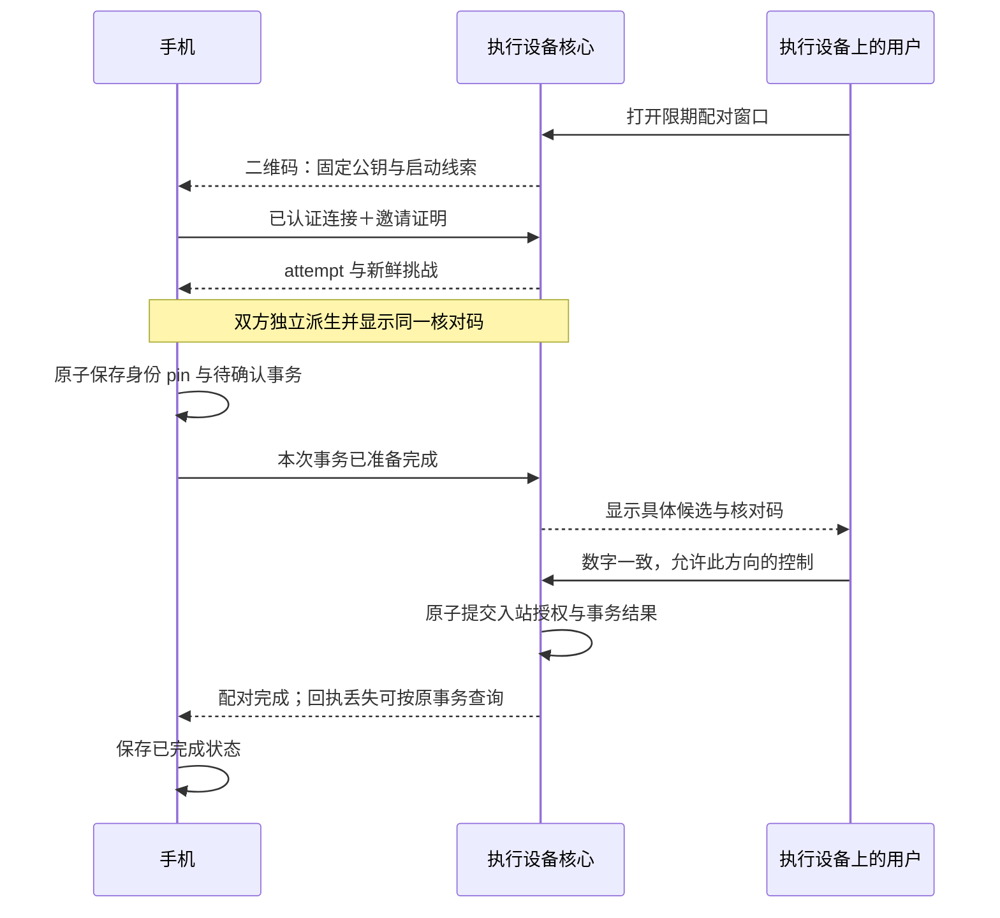

# 远控配对协议

[返回远控契约](remote-access.md) · [产品行为](../prd/remote-access.md)

下述扫码流程以 `Control` 为例。`TelemetryProfileRead` 复用配对状态机，但邀请用途、核对上下文与 grant 独立；它只允许读取遥测配置，见[分享契约](remote-access.md#遥测分享与-wire-v3)。

## 扫码与明确授权

二维码只开放一个有期限、受限的配对请求窗口。手机先从二维码固定执行设备公钥；执行设备从已完成握手的 `remote_id()` 取得手机公钥，不能使用请求正文自报的身份。名称、机型和谁先扫码都不是授权依据。

两端显示相同的八位数字，由执行设备确认“数字一致，允许这台设备控制本机”。数字用于核对具体候选，不是短密码、可提交验证码或业务授权凭据。确认仅通过执行设备的本地可信管理入口执行；GUI 和 headless 消费相同的核心配对契约，无 GUI 不自动放行。本切片提供 headless 可消费的本地核心 API 与隔离驱动，不新增常驻 daemon 或独立 headless 产品。

将手机保存放在执行端授权之前，避免正常客户端本地存储失败时，执行端已经留下无法继续的授权。执行端只允许确认已经声明准备完成的候选；此处确认动作就是提交点，不再增加“用户已允许、手机尚未保存”的阶段。执行端把 grant 和完成事务标识放在同一次原子写入中，成功后才允许业务。最终回执仍可能丢失，因此不宣称跨设备原子提交：手机以此前保存的 pin、事务 ID 和自身私钥重新连接查询。执行端未提交的候选在宿主重启后可明确失效；已提交授权的结果必须可查询，不要求清数据或再次消费邀请。

候选状态为 AwaitingReady、AwaitingApproval、Granted，以及未授权终态 Rejected／Expired／Disconnected。手机保存失败不发送 Ready；执行端保存失败不切到 Granted。取消只能取消未提交候选，不能把已提交授权当作已撤销；已提交结果根据当前 grant 查询，撤销后旧事务不能重建 grant。已核验但未完成的本地记录标为待确认，不能仅因有 pin 就显示“已授权”。

每台执行端同时开放一个配对窗口，默认五分钟、最长十分钟；重新生成关闭旧窗口和未提交候选，保留已经提交的 grant。每个窗口最多五次挑战，候选期限不超过窗口期限。批准记录将当前 grant 与 completed attempt ID 一起原子保存，重复查询只在当前 grant 仍匹配该 peer／attempt 时返回 Granted；旧事务已被撤销、取代或不可查时返回明确的未授权／不可得状态，不能据旧回执重建权限。其余候选在成功提交后失效，邀请随提交消费；未提交状态不承诺跨宿主重启保留。

未授权的配对 RPC 只能开始本次请求、声明准备、查询自身事务或取消；不能操作业务、批准自己、列举其他候选。人工确认使用状态查询／事件，不让一个 RPC 在全局请求锁或并发许可内等待人操作。

### 核对绑定与中断

使用 [TLS 1.3 exporter](https://www.rfc-editor.org/rfc/rfc8446.html#section-7.5)，不增加另一套密钥交换。这里是采用标准原语的 Velune 确认协议，不声称原样实现 RFC 9266 或已经完成密码学审计。

固定专用 ASCII label `EXPORTER-Velune-Pairing-v3`，不含结尾 NUL。context 为固定 131 字节：`u16_be(3) || issuer_key[32] || controller_key[32] || invite_id[16] || attempt_id[16] || challenge[32] || permission_u8`；permission 为 1 时允许 controller 控制 issuer，为 2 时仅允许读取遥测配置；公钥顺序固定角色，用途参与绑定。当前编码见 [`pairing.rs`](../../packages/remote/src/pairing.rs)。仅在完整握手和邀请校验后分配 attempt 与挑战，不使用 0-RTT。两端独立派生 32 字节，取前八字节的大端整数模 100000000，前补零显示八位；不得接受对端自报的显示码。

每个邀请最多产生五次不同挑战，计数原子且不会因取消、断线或换公钥而恢复。同一有效连接／attempt 重试返回原挑战，执行端随机数在候选准入之后生成，防止先批量建立 TLS 再挑选短码。已有本机隔离样例验证了双方一致、上下文隔离和新连接产生新绑定；八位显示仍可能碰撞，标准 exporter 的安全性质不代替产品协议复核，也不证明并发挑战计数已经实现正确。

未确认的挑战绑定原 QUIC/TLS 连接。路径迁移不改连接时保留核对码；连接确认关闭后，旧候选失效，不能再批准。重连若生成新挑战，必须计入同一邀请总预算；不能沿用 attempt 却在新 TLS 上无限重算 exporter。批准、断线和落盘按核心配对状态机串行裁决：结果只能是授权已提交并可查询，或候选失效未授权。已提交 grant 不随确认连接断开而撤销，也不能由旧完成请求重新激活已撤销的 grant。

### 二维码载荷

单码只携带用途与版本（当前为 v3）、执行端稳定公钥、invite ID、32 字节随机 token、到期提示，以及少量直接地址、relay 和 lookup 启动线索。配对后再经已认证连接取得完整资料。编码后目标不超过 512 字节、硬上限 1024 字节，超限明确拒绝生成，不静默改为多码或要求手工处理 JSON；真实可扫性仍需现有手机验证。[QR 容量与密度](https://www.qrcode.com/en/about/version.html) 不等于实际扫码可靠性。

优先复用现有结构化序列化，不为二维码建立通用编码框架。二维码不包含调用世代、永久自动登录秘密或完整地址列表；不通过 HTTP 短链接解析，不执行扫码内容里的任意 URL／命令。邀请和相机帧不进入日志、通知预览或持久分析记录。辅助导入仍进入同一解析和确认流程，不构成第二种授权方式。
