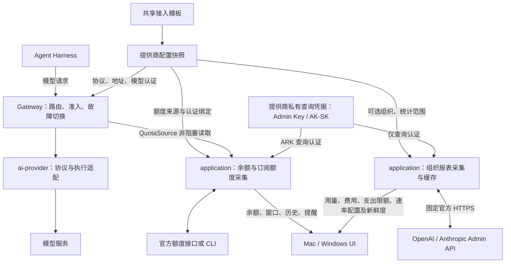

# 账户报告与组织账单

本页维护 application-api、application、bindings 与平台之间的账户报告、组织账单和提供商分析契约。模型调用、认证与订阅额度见[AI 服务](ai-service.md)，产品规则见[AI 提供商](../prd/ai-providers.md)与[分析](../prd/analytics.md)。

## 组织用量与账单

调用配置与账户观测分别建模。共享目录只给出起始快照，协议、执行后端、请求 profile、模型认证、额度来源与可选账单配置各有职责；Moonshot API 与 Kimi Code、OpenAI Platform 与 Codex、Anthropic API 与 Claude Code 分别组合，不按品牌推断接入产品。

`application-api` 定义 `BillingConfiguration`、`BillingScope` 与带类型的报表；bindings／RPC 传递相同契约，平台只呈现结果。提供商私有查询凭据以 `QueryCredential` 区分 API key 与 AK/SK，不进入模型认证解析器或 Harness。`save_provider_billing` 单独原子持久化，保留／替换／清除秘密，不重建模型执行；`provider_billing` 立即返回状态并按需采集。模型认证 generation 变化暂停关联，不支持的目标清除配置。

账单采集只接受 HTTP、Native、API key 和精确官方 HTTPS 主机，查询目标另行固定，禁止重定向与隐式重试。OpenAI 读取 Usage Completions、Costs 与组织／Project Spend Limit；Anthropic 读取 beta Analytics Usage／Cost 与组织／Workspace Rate Limits。API key 范围只取对应报表，不伪装为拥有该范围的限额。外部响应在 HTTP 边界一次类型化；货币按币种累加，Anthropic 费用和 OpenAI 支出阈值由美分转为主币单位，token 细项按官方含义统计。

缓存身份由服务、组织、scope、查询凭据摘要和 UTC 月起点共同决定；同权限、同范围共享结果，平台不汇总重复组织总额。缓存仅在内存，TTL 15 分钟，手动刷新最短 30 秒，失败退避 60 秒；最多 4 项在途，不后台排队。单请求 12 秒、整个采集 45 秒，单页 2 MiB、最多 32 页／32,000 行；重复游标和中途失败拒绝该项总额，独立成功项可保留。删除、换绑、停机取消旧任务；即使删除后重建同一缓存身份，旧任务也不能回写。

报表带明确范围、UTC 统计区间、本地抓取和上游刷新时刻；Anthropic 整段统计按小时截断。部分失败逐项说明，全部失败保留旧报表并标为过期。报表不进入 `QuotaSnapshot`、准入、历史或提醒；配置限额不是余额，也不是此刻的剩余速率。接口语义依据 [OpenAI Costs](https://developers.openai.com/api/reference/resources/admin/subresources/organization/subresources/usage/methods/costs)、[Spend Limit](https://developers.openai.com/api/reference/resources/admin/subresources/organization/subresources/spend_limit/methods/retrieve)、[Anthropic Analytics](https://platform.claude.com/docs/en/manage-claude/usage-cost-analytics-api) 与 [Rate Limits](https://platform.claude.com/docs/en/manage-claude/rate-limits-api)。

## ChatGPT 账户报告

账户报告和额度窗口分别建模。`usage` 中的 usage credits 保留来源字符串与 `has_credits`／`unlimited` 标志，不塞入 ISO 4217 货币余额；banked reset 保留可用次数和权益明细，不写入额度历史或自动兑换。`usage` 已报告可用次数而权益详情接口失败时，仍保留已知次数，明细保持未知。

账户用量读取 `profiles/me` 根级 `stats` 与 `metadata`。累计 Token 与按日期的 Token 不补造输入／输出细分或请求数，日期标签沿用来源；`stats_as_of`、`generated_at` 和本地抓取时间分别传递。`stats_error` 不能被 HTTP 成功掩盖，未报告与明确的零值不同；缺失日期桶和明确的空集合分别传递。部分刷新保留旧分项时，也保留该分项原观测时刻，不以其他分项的成功刷新替它更新时钟。

采集复用 Velune 管理的 ChatGPT 订阅认证、刷新与失效处理，仅向固定 `chatgpt.com` HTTPS 的三个 GET 目标发送凭据，不跟随重定向。账户认证代际决定结果归属，删除、换绑和停机使旧采集失效；数据需求、缓存与局部错误不改变模型执行或网关准入。账户报告不依赖是否选择了额度窗口来源。

字段和 GET 行为参考 [Codex Switcher 的固定版本](https://github.com/Lampese/codex-switcher/blob/cb35db986756391daa8ac5d48179579bafc6e6a0/src-tauri/src/commands/account_stats.rs) 与 [Codex reset 客户端](https://github.com/openai/codex/blob/main/codex-rs/backend-client/src/client/rate_limit_resets.rs)。这些 ChatGPT 后端端点不构成公开稳定 API 的承诺；不支持或结构变化按不可用处理，不伪造余额或空报表。

## 提供商分析与汇总

应用层读取账户报告和已有组织报表，bindings／RPC 传递同一份有类型结果，平台不自行采集、重新认定账户或计算去重。账户权益按账户身份区分，`profiles/me` 在工作区间的隔离未经证实时，不能把同一主体的多个工作区配置当作独立用量相加。组织报表按服务、组织与范围识别重叠，查询密钥不同不等于统计对象不同。

累计 Token、来源日期桶、组织 UTC 本月和各币种费用分别汇总；输入已包含缓存的组织报表不能再次加缓存细项。同月且范围互斥的组织快照可以汇总各自最新已报告量，同时保留最早／最晚截止时刻并在不同时说明，不宣称所有来源使用同一精确截止时刻。本地网关记录不是额外消费来源，永不加到提供商总量。汇总保留已知贡献与排除原因，来源失败、旧数据、缺失指标及不同截止时间随明细传递，不因一项失败抹去其他独立成功项。
