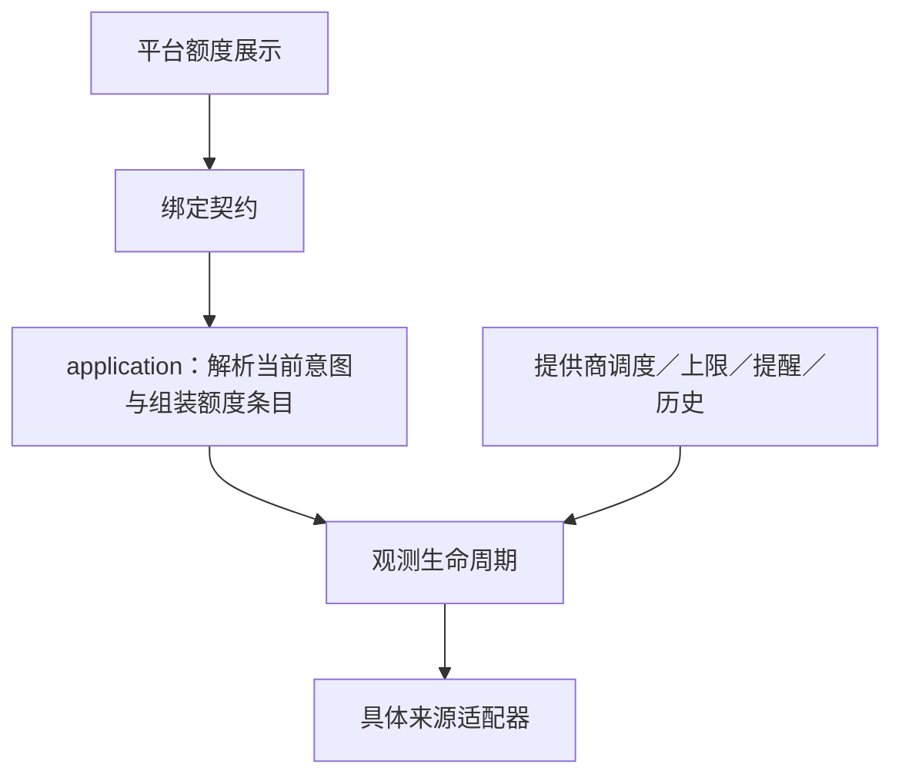

# 额度模块边界复核

状态：2026-10-28 的技术方案复核，基于 `3ee35a1`。本文保留当时的实现与重构建议；用户随后授权实施，当前结果及验证见 [任务记录](packet.md)。用户要求重新检查 CC 额度的区块、模块边界及依赖方向。

## 当前实现与问题

界面没有独立的 CC 视图组件。`StatusDetails` 对 `accounts` 统一循环，复用 `QuotaWindowRow` 和 `QuotaStatusText`；CC 登录额度作为一个来源进入这组组件。但原生历史 `rateLimits` 仍在另一条分支展示，因此整个额度入口还没有统一。

| 位置 | 观察到的事实 | 边界后果 |
| --- | --- | --- |
| `app/mac/ComposerQuota.swift` | 持有完整 AIProvider／RuntimeInstance，展开 managed 路由、去重提供商、筛选模型窗口。 | Mac 拥有了业务来源解析。另一个平台要复制这些规则。 |
| `app/mac/Store.swift`、`StatusLine.swift` | 根据选择与能力标志切换两套读取，并决定何时抹去历史 rateLimits。 | 额度来源和历史观测的取舍分散在客户端与视图中。 |
| `packages/application/src/runtime_quota.rs` | 通用名字下硬编码 CC variant、binary／agentDir、执行位置约束与具体采集器，同时维护缓存、退避和取消。 | 来源适配与观测生命周期混在一起，接入下一种原生来源还需修改通用服务。 |
| `packages/application/src/local/mod.rs` | 运行时能力直接比较额度服务的 SUPPORTED_RUNTIME 常量。 | 能力声明依赖某个采集服务的内部支持列表。 |
| `packages/application-api/src/records.rs` | RuntimeQuotaStatus 复用 ProviderQuotaWindow；Swift 将两种结果映射为 AccountQuota。 | 中性观测只在 Mac 层被统一，核心公开契约仍以提供商命名。 |
| `packages/application/src/subscription_quota.rs` | 同时持有来源绑定、观测、调度状态、上限、提醒与历史。 | 不能为了原生显示而直接复用整个服务，否则原生观测会意外获得提供商策略。 |

这些事实违反了 [Product TDD 的分工](../../docs/product-tdd/index.md#平台-app-与-application-的分工)：核心负责产品规则，平台负责呈现。当前 application 依赖 gateway／agent-runtime 的 package 方向本身符合装配职责；问题主要是模块的责任分配，不是发现了 crate 之间的循环引用。

## 建议的边界

application 提供“当前 composer 上下文的额度”用例，输入引用下一轮意图的明确上下文，输出具备来源语义的额度条目。来源解析必须覆盖 managed 直连、路由、原生与默认选择，由核心持有路由展开、窗口适用范围及历史观测适用性规则。绑定只传递结果；平台不传入自行解析的账户列表。

来源适配器负责将具体来源读取为中性观测。CC 适配器拥有 CLI 命令、用量文本、登录目录和执行位置约束；这些细节不进入通用观测服务或 composer。它可以继续由 application 装配，并为提供商及原生登录复用，不必为形式上的分层移动到 gateway 或建立新 crate。

观测生命周期负责 freshness、并发合并、有界采集、退避、取消与迟到结果拒绝。提供商策略消费观测，负责调度、上限、提醒与历史。原生登录的展示消费同类观测，不自动加入提供商策略。

公共值类型表达窗口、余额、观测时间和状态，不使用 Provider 前缀。来源描述需保留“提供商账户”“运行时登录”“会话记录”等语义和范围；统一数据形状不代表这些身份可以互换。UI 可以据此分组和标注，但无需认识 CC、Codex、配置路径或认证对象。

建议调用关系：

图中的边是调用依赖。数据按返回值流回；gateway 仍只消费 application 提供的调度快照，不查运行时配置，也不获取登录状态。

## 重构范围与约束

先把来源解析和额度条目组装移到 application，消除 Mac 的路由展开和两套来源选择逻辑。查询接受与发送一致的显式运行时及模型选择；现有 nextTurnModelSelection 返回已准备会话的选择，不能当作完整 composer 意图。路由需要遍历全部成员，不能以只返回首成员的 resolve_dispatch 代替。再从 RuntimeQuota 中分离 CC 的来源捕获规则，使缓存代码不认识 Harness 的名称、版本和目录字段，同时统一公开观测值类型。小型类型枚举与集中分派即可，不建立插件框架。

本轮保持两类缓存及其消费策略分离，不先拆解整个 SubscriptionQuota。上图中的“观测生命周期”表示职责，不要求立即只有一个服务实例或存储。原生与提供商已经共享 CC 采集器；当前优先修正来源解析和展示投影，而不是为了代码复用扩大账户状态的共享范围。

共享采集机制与共享一份账户缓存是两个决定。只有核心能够证明绑定到同一观测来源，才可以共享缓存；不能凭模型名、运行时名或路径相同就合并账户。来源发生变更时必须撤销旧观测，并保留现有 generation／incarnation 隔离。第一步不建立全局账户注册表，不自动合并现有 provider 历史或账户策略。

已有无窗口验收保留，并将主断言移到核心公开用例：没有提供商时原生与默认选择仍有条目；同名模型的不同账户不串用；路由只展示适用窗口；不支持的执行位置有明确状态；更换／删除来源后旧结果不发布。另需证明原生只读查询不会改变 gateway 的可用性、额度上限、提醒或历史。平台验证只负责呈现契约和组件行为，不再实现一套选择规则作为 oracle。

## 需要补上的归属验证

按当前代码推演，conversationStatus 无条件取历史最后一份 rateLimits，而 StatusLine 只在 managed 或支持主动查询的原生运行时下清空它。因此，从有 Codex 限额记录的会话切换到另一种、不支持主动查询的原生运行时后，旧限额仍可能出现。该风险尚未运行复现，不能写成已经发生的用户故障。重构后应由核心保留历史的来源与观测语义，并验证旧限额不会作为新运行时的当前账户额度展示。

独立顾问复核支持上述收敛范围，并强调保留提供商侧的账户归属确认、generation／incarnation 隔离，以及原生登录不代表实际计费账户的现有契约。建议已采用；全局账户缓存和通用插件注册体系不进入本轮建议。
