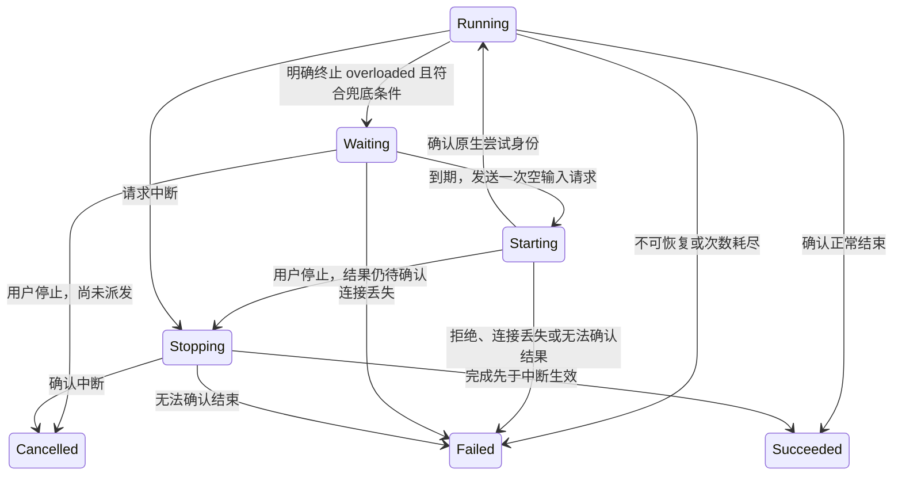

# 输入区与执行生命周期修正方案

状态：2026-10-30，经独立 advisor 评审修订活动周期语义后，用户已要求落地；实施与证据见 [计划](plan.md)。依据用户要求设计上一轮架构审查中六项问题的解决方案。本文件是当前任务的方案，不代表已实现或已接受的项目契约；当前状态与既有证据见 [packet](packet.md)。

## 目标、约束与已核实事实

保持已确定的产品行为：输入区状态随布局确定归属；steer 加入当前执行；过载恢复不重发用户输入；只有正常结束才自动折叠；主动压缩不重新打开上一用户轮次。权威需求见 [输入区](../../docs/prd/composer.md)、[会话展示](../../docs/prd/conversation-view.md)与[工作区布局](../../docs/prd/workspace-layout.md)。

已核实的机制决定方案边界：

- [ApplicationService](../../packages/application/src/service.rs) 在同一 owner 线程推进全部会话；自动重试不得在该路径等待原生应答。
- `application-api::resolve_next_turn`、`change_next_turn` 已是共用的解析与选项变更规则；Mac 应继续调用它们。
- 一个用户执行的展示范围可含多条 steer 用户消息；每次显式发送／继续形成一次活动周期，该周期可含多次原生尝试；界面仍按用户消息划分工作段。范围、活动周期、原生尝试与展示段不能用“最后一条用户消息”互相代替。
- 续接、侧聊过滤和 live→native 确认会转换消息身份；原生分支点仍是传回运行时的 opaque 值，不能当展示 ID 改写。
- 真正的 Codex 夹具已观察到原生重试；继续保留“明确终止 overloaded、该原生尝试没有宣布重试时才兜底”的规则。
- 原生会话是持久化权威，Velune 不新增会话日志。新增执行关联只随当前内存快照存在，重开时依原生证据重建；缺证据保持未知。

本轮设计覆盖六项审查问题和与其直接相关的草稿变更通知。缓存到期前自动压缩仍是独立提案，未纳入实施范围；不改既有侧聊布局或 SVC 重装流程。

过载兜底复用原有会话及模型／路由配置，不引入 provider fail-over，也不改变已有网关路由策略。重试耗尽后停止自动恢复；只有用户明确点击“继续”才建立新的活动周期。用户主动改选下一轮配置是已有交互，与自动重试分开处理。

## 路线选择

| 路线 | 同一使用场景下的结果与代价 | 判断 |
| --- | --- | --- |
| 在现有字段上逐处补判断 | 聚焦切换时补 attach、结束时多找几条消息、断线时补改 retry 文案，改动较少；状态归属仍由隐式调用顺序决定，每个新出口都要协调这些补丁 | 不选为目标结构 |
| 显式输入上下文、统一执行关联、非阻塞恢复 | 需要调整适配器内部契约及转录输入；输入归属和结束结果各有明确写入者，现有公开展示模型继续使用 | 推荐 |
| 把原生尝试与恢复全部搬到 application 的通用任务管理器 | application 需要接收更多协议级事实并协调起轮应答，扩大接口与生命周期；当前已验证的兜底仅属于 Codex，收益不足以覆盖这层迁移 | 本轮不采用 |

选择第二条。重试作为适配器对一次用户执行的实现细节留在 `agent-runtime`；application 继续拥有队列、通知、网关和完整用例。各层能通过统一终态组合，而不分别猜测某次原生失败是否已经结束用户执行。

## 职责与数据流

| 责任 | 唯一写入者 | 消费方与限制 |
| --- | --- | --- |
| 布局、焦点和本次命令的输入区／目标配对 | Mac 窗口模型 | 视图和命令读取同一上下文；挂载、卸载不改变选择归属 |
| 草稿和用户明确的选择 | 会话模式沿用既有会话草稿／选择存储；独立模式由窗口的 ComposerModel 保存 | 两个模式各自保留状态；只有用户动作或一次初始化写入 |
| 选择的含义、可用选项与有效请求值 | application-api 的共用解析函数，执行端再次校验 | UI 不复制“沿用当前”、模型目录或权限的业务规则 |
| 原生尝试的事实及每次活动周期的结果 | agent-runtime 的执行跟踪；具体适配器解释原生协议 | application 按活动周期消费结束；转录投影读取执行范围的最新结果 |
| Codex 恢复阶段、期限、次数及本次取消意图 | 当前活动周期内的单个恢复状态 | 原生控制和展示均由此派生，消息块不能反向驱动恢复 |
| 原生引用到展示引用的转换 | application 的快照装饰入口 | 消息、执行关联、身份确认一起转换；不改写原生分支点 |
| 工作段、独立维护状态和结束结果的展示投影 | transcript 的原子快照替换 | 平台只渲染和保存手动展开状态 |

### 输入区：窗口确定上下文，视图只呈现

窗口提供一个短生命周期的 `ComposerContext` 值，明确包含草稿 owner、目标 tab／会话引用及由共用规则解析的下一轮值。它不是第二个会话 store，也不持久保存目标。

- 编辑面板、普通发送 sheet 使用对应会话的草稿 owner；独立停靠／浮动／工具窗口使用所属主窗口的 sharedComposer。
- 普通窗口命令执行时取当前聚焦目标；sheet 命令取该 sheet 的明确目标。面板是否收起不参与 owner 的选择。
- 选择菜单、命令面板、斜杠命令、额度查询、发送资格和发送统一消费此上下文。`ConversationStore` 提供会话事实、目录加载及执行接口，不再安装弱引用 `composerIntent` 来改变自己所有方法的含义。
- `ComposerContext` 用目标历史、目录及草稿 owner 的明确选择调用 `resolve_next_turn`；选择改变经 `change_next_turn` 校验后写回同一个 owner。Store 可保留会话模式的默认解析便捷入口，不能把独立选择写成会话模式。
- 独立输入区首次启用时由窗口动作初始化一次；有恢复值时优先恢复。初始选择只取目标的明确选择，未选项保持未选，不把“沿用当前”的解析值冻结成指定模型；不复制会话的文字和附件。此后换布局或目标不重新初始化。
- 目录未加载或某选择不再可用时，保留用户选择，由共用解析结果说明可用性；异步目录返回不得覆盖草稿 owner。

例：在会话 A 上，用户把独立输入区选为模型甲，收起底部区域，切到会话 B，再由用户在命令面板改选模型乙。改变的是独立输入区；B 原来的会话选择不变。重新展开仍为模型乙，普通发送发往 B。未明确指定的字段按 B 解析。

发送／排队／继续捕获不可变的请求值：目标引用、草稿 owner 与版本、正文、附件及已解析的选择。提交进入执行端后，切换焦点不能改变请求目标。排队沿用核心已有的 `TurnRequest`，steer 沿用正在执行的配置。成功或失败回包仅处理原来的草稿 owner，用户之后的编辑不能被回包清除或覆盖。选择本身不随发送清空。

原生文本框的提交回调在动作开始时向窗口取得上下文，不能长期捕获上次渲染时的 tab。异步目录与额度查询同样带目标及选择版本，旧回包只能填充对应来源，不能覆盖新目标的显示。

`ComposerModel.attach` 仅负责原生文本视图等编辑连接，不决定产品状态归属。删除 `ConversationStore.useComposerIntent` 及对应弱引用与隐式模式切换。

草稿保存改为消费显式的正文／附件／选择变更信号。信号在语义写入完成后发布，可继续 debounce 保存；焦点、输入法状态、补全和高度不承担保存触发责任。窗口关闭或进入系统恢复保存点时提交最新值。会话模式继续使用原有核心存储，独立模式沿用 `SavedWindowLayout`；不新增草稿数据库。

### 执行：范围、活动周期、原生尝试与展示段

在 `conversation` 的内部完整快照中增加最小执行关联，示意如下，具体命名在实施准备时落定：

```rust
ExecutionRecord {
    id,                 // 当前快照命名空间内的 opaque 身份
    kind,               // UserTurn 或 ContextMaintenance
    message_ids,        // 该执行拥有的消息引用，包含全部 steer 片段
    outcome,            // 最近活动周期的确认结果；未知或正在执行时为空
}
```

完整快照携带这些记录及当前活动引用 `{activity_id, execution_id}`。`activity_id` 可复用连接世代与本连接递增序号，仅用于分辨每次显式操作及其终态；终态引用保留到下一次操作，纯历史读取为空。application 按活动身份精确消费刚结束的操作，不能只按展示执行 ID 永久去重。关联不复制正文，不导出为新的平台业务模型，不持久保存。

**活动周期的承诺：** 每次用户明确发送／继续，以及每次主动压缩，建立新的活动周期；steer 与自动重试不建立新周期。周期重新捕获本次配置，初始化恢复预算与取消意图。显式继续保留原执行的展示范围，但清除其当前终态，让本次周期产生新的结果。这里仅为既有提交与观察流程增加明确关联，不新增持久账本或另一套任务管理器。

例：当前配置的五次自动恢复耗尽后，用户保持模型／路由配置不变，主动点击“继续”。继续周期仍使用该配置，重新初始化五次恢复预算及取消状态；周期内自动重试不再重置预算。该周期结束时 application 再处理一次通知、遥测和资源清理，原消息的配置与用量不被改写，已有发送队列暂停决定也不被继续成功解除。若用户在继续前主动修改推理强度等选项，新周期捕获其明确选择；自动重试不会自行改选。

`agent-runtime` 的轻量执行跟踪维护记录与当前阶段；具体适配器把协议事实交给它。跟踪只负责本连接已有的发送、steer、继续和压缩，不形成通用任务框架。

- 新用户发送建立用户执行及首个活动周期；之后的用户、assistant、工具和系统消息关联到它。steer 增加成员，不新建执行或周期。
- Codex 原生重试和 Velune 兜底尝试都保留当前活动身份。中间原生失败只结束当前尝试；恢复期间该周期不发布终态。
- 用户显式“继续”建立新周期，沿用可恢复的上一用户执行的消息范围；本次周期捕获新选择，但不改写原消息的发送配置和原有用量。普通新消息另建执行。
- 主动压缩建立独立的 `ContextMaintenance` 和活动周期；轮次内自动压缩属于当前用户周期。
- adapter 在实际结束证据到达时，每个活动周期一次性确定结果。取消请求只是意图；若原生先确认正常完成，应如实记录 Completed。连接异常走失败出口，不能因为控件闲置而推断成功。
- application 的 `record_finished_turn` 读取该活动及其结果，再决定通知、队列和遥测；删除按最后一条用户消息补写结果和 `unwrap_or(Completed)` 的推断。每周期的结束处理不依赖遥测是否启用，也不新增跨重启去重存储。

Codex 的当前原生 turn ID 和 pending RPC 属于本次尝试；逻辑执行 ID 与它分开。Pi、Claude、DSH、ACP 同样在各自明确的请求与结束事件边界更新跟踪。历史适配按实际原生 turn／条目建立关联；没有边界证据时不猜测 steer 或结束结果。

执行准备须把完整历史投影（消息和执行关联）一起交给 adapter，不能仍只传 `Vec<Message>`。同一会话和引用仍有效时，可沿用本连接前已观察的展示关联；原生来源改变或引用失效时重建。重连不从历史激活旧活动，新的活动身份只在新的显式操作入口生成。终止出口只处理当前未终止的周期，闲置连接关闭不能改写上一周期结果；显式继续才允许为已停止／失败的用户执行开启新周期。

迁移不能把 `turn_failed: bool` 原样搬成结果。实施准备须列出各适配器的最小结束来源映射：哪些原生事实证明 Completed／Cancelled／Failed，哪些只证明活动已结束。例如 Pi 的 `stopReason=aborted` 必须保留取消含义，`agent_settled` 只能确认忙碌结束，不能独自证明成功。没有成功证据时结果保持未知，结束忙碌状态，不自动折叠，也不触发正常完成的队列推进。

删除 `Message.turn_outcome` 和适配器中“结束时写最后一条 user”的分支。结果由执行记录拥有，`TranscriptTurn.outcome` 保留现有对外字段，由工作段所属的执行记录计算。因此一个执行中的多个 steer 工作段会收到同一终态。

这项调整的代价是要同时更新适配器与历史投影；收益是增加一种结束路径时只需确定执行结果，不再修改消息查找、应用补记和展示结果缓存三处。

### 身份与转录：一次转换，一份输入

application 装饰快照时，通过同一个引用转换入口处理 `Message.id`、执行 ID、执行的消息引用、当前活动引用中的执行 ID 与身份确认。活动身份用于识别控制周期，不能当展示消息或原生 turn ID 改写。续接使用段命名空间；侧聊过滤继承消息时同时裁去关联，剔除没有可见成员的执行。原生 `branch_point`、原生会话 ID 等控制引用保持原义。

live→native 确认在适配器中同步替换执行成员引用，再把确认交给展示以保持行身份。分支、删除、原生历史替换都须裁剪失效引用；无法保留结果证据时回到未知，不把结果迁给另一段。

`TranscriptProjection` 原子接收同一份快照的消息与执行记录；不再分别接收外部 `finish(raw_user_id)`。删除它的 `outcomes` 可变补记表。时长与展示行身份仍是该可丢弃投影的职责。

- 展示继续以用户消息划分工作段；共同属于一个用户执行的段共享结束结果。进度位置及计时仍按实际观察区间处理，不给旧段额外累加时间。
- 用户执行里的压缩进行中独立可见，完成后进入该段工作；错误和恢复记录也按发生顺序进入工作。系统状态到达不改变最终 assistant 正文的回复归属。
- 独立维护的状态始终独立呈现，包括完成、失败与取消，不进入上一用户轮次。原生历史无法判明归属时保持独立，不从消息位置猜测。
- 原生进程释放后，已观察的执行关联随 History 快照保留；重新读取来源时按原生证据重建。缺少持久证据的历史不保证保留本机观察到的折叠结果。

### Codex 恢复：一个状态出口，起轮不等待应答

`codex_retry` 保留当前适配器私有职责；以明确阶段替代散落的 pending、文案和收尾修改。单个活动周期保存固定的恢复配置、次数和期限，各次原生尝试保存 ID、原生重试事实及其错误引用。显式继续开始新周期并重置这些值；自动重试保留它们。



约束与出口：

1. 继续使用 2、4、8、16、32 秒、最多五次的策略；只有明确终止的 typed overloaded 且本次原生尝试未报告重试时才安排。主动压缩不进入该循环。
2. 期限用单调时钟；界面时间是其展示投影。模型、网关注入、effort、权限固定为本次活动周期捕获的请求值，后续 composer 选择不改变它们；下一次显式继续才重新捕获。
3. 到期使用现有 `RpcClient.begin` 发起一次 `turn/start`，登记请求 ID 与应答期限后立即返回。poll 处理回复、通知及超时；恢复路径不调用同步 `request` 等应答，也不新建等待线程。
4. 将原生参数构造与“同步等待／异步派发”分开复用；保留现有普通发送的受理语义。本轮不把全部业务 API 改为异步。
5. 应答与 `turn/started` 可先后到达：按当前连接、线程和请求关联，最先确认的原生 turn 身份绑定到尝试，之后到达的身份必须一致。身份未确认前的有关事件有界暂存；到期或越界按协议失败结束，不能丢掉终态再等待。无关线程沿用现有子 Agent 路径，不接管为本次尝试。
6. 起轮应答尚未到达时，停止只设置取消意图并显示停止中；一旦取得原生 turn 身份，异步发送中断。不得把“没有收到应答”解释为“请求没有执行”。明确拒绝后结束；连接丢失或结果未知时失败并提示原因，不再次派发。
7. 等待和起轮中都属于同一活动周期：队列不推进、网关不释放；steer 在没有确认运行中的原生尝试时不可用。每周期只发布一次终态，application 再按既有后台工作约束释放资源；同一展示执行随后显式继续时，新的活动终态仍须被处理。
8. 正常完成、停止、耗尽、起轮拒绝、协议失败、断线和关闭均经过同一终止方法。明确关闭会话会撤销尚未发出的等待，并沿用既有运行时关闭流程处理已派发操作；晚到应答不能重新激活已结束周期，也不能完成后续周期。

`RuntimeRetry` 是只读展示值，在投影出口从上述状态生成；不再随错误消息各自手动更新。保留当前公开字段和变体：成功映射 Recovered，用户停止映射 Cancelled，已知的兜底耗尽映射 Exhausted。连接或派发失败清除 Waiting／Native 等进行中标签，并追加归属当前执行的 typed 失败原因；不伪造重试次数，也不把失败称为“用户停止”。原生重试终止失败时同样清除进行中标签。错误正文完整时 `Message.completed` 为真，不靠伪装内容仍在流式输出来维持退避状态。这样无需为内部阶段新增远控 wire 变体。

已有的进程管理、网关释放与原生工具运行语义继续适用。空输入继续避免重新发送已有用户消息；它不承诺模型之后不会再次选择调用某个工具。

非阻塞保证针对恢复计时、起轮与待答中断，不声称把已有的运行时准备、历史读取及进程清理全部异步化。验证其他会话可被服务时，应使用已加载会话与受控应答屏障，隔离正在修复的等待路径。

## 过渡与文档归属

实施应形成三个可独立检查的改动单元；这只是迁移边界，具体执行顺序与步骤留给实施准备阶段：

- **执行关联与投影**：原生／历史适配器、应用装饰及 transcript 同步切换到执行记录；同一改动删除消息结果字段和 projection.finish 补记。主动维护分组在这个单元收敛。
- **恢复生命周期**：在已有执行关联上合并状态与终止出口，起轮与中断改用异步待答；保留原先已通过的原生重试与无输入恢复语义。
- **Mac 输入上下文**：统一所有命令、选择与提交入口，移除 Store 的独立模式覆盖，改为显式草稿变更保存。

中间状态不能交付“部分适配器写新结果、部分消费者读旧结果”的版本，不保留长期双写或兼容分支。`ExecutionRecord` 留在内部完整快照，平台仍接收既有 `TranscriptTurn`、`DeliveredBlock` 与游标；本方案不要求远控协议或持久配置迁移。

方案接受并实现时更新现有权威文件：在 [Product TDD](../../docs/product-tdd/index.md)明确区分核心解析规则／会话存储与窗口独立编辑缓冲；在[架构设计](../../docs/design/architecture.md)与 [agent-runtime README](../../packages/agent-runtime/README.md)记录执行、尝试、展示段及身份转换；在 [Mac README](../../app/mac/README.md)记录输入上下文和恢复保存。主动维护与轮次内压缩的差异回写已有 PRD 段落。设计提案现阶段不覆盖这些文档的有效契约。

## 后续验证必须区分的结果

以下是方案约束和后续验证的判据，尚不是修复通过的证据。当前审查夹具可作为失败基线复用。

| 审查项 | 条件与观察边界 | 修复后的判据 |
| --- | --- | --- |
| 1：重试阻塞 | A 到期起轮后用应答屏障保持未确认；同时对已加载 B 查询快照、停止，并停止 A | 屏障释放前 B 请求已完成，A 可观察为停止中；放行身份后仅一次中断；不必等原生超时才能服务其他会话 |
| 2：输入归属 | 用户把独立输入区选为模型甲→收起→切到会话 B→用户在命令面板改选模型乙→展开并提交；另测 sheet、两窗口及跨设备目标 | 文案与实际合成请求都是模型乙，目标为 B；B 的会话选择不变，另一窗口草稿不变；晚到回包不覆盖后续输入 |
| 3：身份转换 | Pi live→native 确认、跨运行时续接段前缀、随后正常／失败／停止 | 相同执行成员转换后仍有正确结果，消息无悬空引用；结果不消失也不串到其他段 |
| 4：steer | 同一执行含两条以上用户消息与工具，再正常完成、失败、停止或显式继续 | 所有相关工作段共享正确终态；只有确认正常完成才默认折叠；原请求配置不被继续改写 |
| 显式继续的新周期 | 过载耗尽→保持模型／路由配置并主动继续→再次过载→正常完成；另测用户主动修改推理强度后继续；保留此前暂停的发送队列 | 自动恢复始终不自行换模型或路由；新周期有新的预算，仅在用户明确修改选项时捕获新值；周期内重试不重置预算；每周期仅处理一次终态，继续成功不解除已有队列暂停 |
| 原生结束原因 | Pi 的 stop／error／aborted 与仅有 settled 的对照；其他适配器按实施准备列出的终态来源 | 分别取得明确成功／失败／取消或未知；结束忙碌不等于成功，未知不折叠或自动推进队列 |
| 5：恢复收尾 | 退避、派发未确认、运行中分别断线／关闭／拒绝；原生先宣布重试再失败；应答与通知交换顺序 | 没有终态之后仍承诺重试的标签；没有双重起轮、未知结果重发或晚到应答复活；队列与通知只响应用户执行的终态 |
| 6：压缩归属 | 上一轮已完成后主动压缩成功／失败／取消；对照用户轮次内自动压缩与不明历史记录 | 主动维护结果一直独立可见且不改变上一轮；轮次内压缩完成后归入该轮工作；不明历史不猜归属 |
| 草稿保存 | 已有非空单行文字继续编辑，关闭临时应用窗口并由系统恢复重建进程 | 正文、附件引用和明确选择恢复；测试直接观察草稿语义变更，不依赖输入法／焦点通知；撤销只承诺窗口存续期间 |

核心判据优先用合成协议夹具保护关联与状态出口，Mac 组合路径使用隔离 HOME／独立 bundle 的原生 UI 自动化。真实 CLI 只连接合成回环上游验证原生重试、空输入继续和既有侧聊；不读取真实会话或凭据，不调用真实服务，不退出当前日常 Velune。普通运行时、远控 typed 交付与各平台展示的构建检查按最终影响面安排。

本方案没有等待用户补充才能成立的技术分支。用户已授权实施，组合判据继续作为验证依据。
