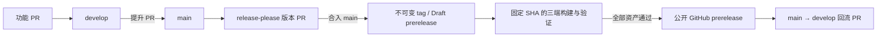

# 首个公开 Beta：发布方案

用户已确认自动备份迁移、AGPL-3.0和英文主页配完整中文，现进入实现。用户没有发布材料，首beta准备固定密钥签名的Android APK、ad-hoc签名且未公证的macOS包和未做发布者签名的Windows包，发布说明列明安装步骤。本文件不代表已成功发布。

## 首次发布的边界

产品统一使用 `0.1.0-beta.1`，后续 beta 递增。一个产品版本覆盖桌面完整端和手机控制端，Rust 内部 crate 不各自发布。公开产物只能来自干净、可追溯的提交，不能由当前混合工作树直接打包。iOS 继续提供源码构建，不把 GitHub Release 描述成 iOS 安装渠道。

发布前确认并冻结各端应用身份、数据目录和签名密钥。沿用现有日常身份比顺手更换隐藏bundle ID更有利于已有数据的连续使用；若要调整身份，也必须作为单独迁移处理，不混在README或品牌装潢里。

| 产物 | 首批目标 | 公开前的必要条件 |
| --- | --- | --- |
| macOS App | macOS 15+，arm64 / x64 两份 | 首beta为嵌套代码ad-hoc签名，未公证；发布页说明系统信任限制与手动打开步骤 |
| Windows App | x64，自包含完整目录 zip | 包含全部 DLL／resources，解压可运行；如未做 Authenticode，须在下载页明确说明 |
| Android APK | Android 9+，arm64 | 正式、持续保管的签名密钥，apksigner 验证，可覆盖升级同签名版本 |
| 源码与声明 | 对应同一 tag | 项目许可、对应源码及上游声明可获取，不遗漏桌面 RelayKit 义务 |
| 发布元数据 | 与全部资产一起 | SHA-256、源码 SHA、产品版本、平台构建号、架构、工具链及数据格式基线 |

GitHub 当前公开 runner 明确提供 `macos-15` arm64、`macos-15-intel` x64、Windows x64 和 Linux Android 构建环境；具体工具安装与首轮构建仍需验证，不能从 runner 存在推断产物已可用。[官方规格](https://docs.github.com/en/actions/reference/runners/github-hosted-runners)

## 新发现的发布范围决定

Windows 的固定 WinAppSDK 预编译包适用 Microsoft 分发条款。独立复核认为，self-contained 部署本身不能决定 AGPL 的 System Libraries 资格，Microsoft 条款也不能被概括成禁止一切 AGPL 应用。当前尚未确定该固定组合满足系统库例外的依据，NuGet 包也没有精确对应源码的 commit 映射。公开 Windows 资产的许可准备仍未验收，构建源码继续保留。[AGPL 本文](../../LICENSE) · [Windows App SDK 部署说明](https://learn.microsoft.com/en-us/windows/apps/package-and-deploy/deploy-overview)

已请用户选择先发布 Mac／Android、Windows 待路径明确后补发，或保持三平台同时首发并整体等待。实现保留当前三平台要求，source helper 在 Windows 覆盖未闭合时失败，平台构建依赖此 gate，发布器再次核对源码覆盖与二进制平台集合。发布范围变更由用户决定。

Android 的固定发行密钥与旧 debug 包签名不同。旧包的设备身份、配对及未发送内容位于禁用系统备份的私有目录，现无跨签名恢复入口。已请用户选择补齐加密导出／导入后发布，或新安装先行、旧调试版保留原安装等待转移。此决定也待答。

## 版本与分支的权威

采用 `develop` 作为日常集成与默认分支，`main` 作为发布源码权威。`main` 已通过 GitHub ruleset 禁止直推、强推和删除，没有绕过者；solo 维护仍能合并自己的 PR，不要求凭空增加第二个审批人。CI 落地后再将具名汇总检查设为必需项。main仅允许保留祖先关系的merge提交，方便版本回流。

采用 release-please simple 的一个根产品 release 单元，并明确 `target-branch: main`。版本源遵循其标准 `version.txt` 约定，自动化 manifest 保存工具的已发布基线，App 只读取版本源。

每次发布多一次提升和一次回流 PR，换取工具的原生版本/标签语义；不另写一套分支、树摘要与候选版本账本来减少点击。回流带回版本和 changelog，下一次提升前应完成，避免版本倒退。热修复从 main 开 PR，仍走版本 PR 和新 tag，再回流 develop。

根 `version.txt` 是完整 SemVer 的唯一来源，各平台读取它；Mac ShortVersion 用数字核心，DisplayVersion 保留 beta 标识。Android versionCode 和 Mac BundleVersion 使用同一个单调发布构建号，CI 由稳定的 release workflow run_number 提供，本地开发可默认 1；不将 SemVer 压成带任意范围限制的整数。

release-please 负责版本 PR、changelog、tag 和 draft。GITHUB_TOKEN 创建或更新的版本及回流 PR 会触发需要维护者批准的原生 `pull_request` CI。维护者在审阅 PR 时批准运行，具名检查通过后再合并。合并后的固定 SHA 构建放在 release workflow 的下游，产物齐全后自动公开。首轮提升合并消息显式包含独立的 `Release-As: 0.1.0-beta.1` trailer，后续由标准 prerelease 策略递增。[GitHub 事件规则](https://docs.github.com/en/actions/how-tos/write-workflows/choose-when-workflows-run/trigger-a-workflow) · [必需检查的事件范围](https://docs.github.com/en/pull-requests/how-tos/merge-and-close-pull-requests/troubleshooting-required-status-checks#checks-from-some-workflow-jobs-are-not-evaluated)

构建失败保留 draft，不公开半套资产。基础设施故障可对同一 tag 重试；已公开 tag 和二进制不替换。源码修复产生下一 beta，更新日志说明修复。签名材料缺失不能自动降级成可下载的未签名 Android 包或假称已公证的 Mac App。

## 数据升级承诺

用户数据与可重建缓存分开。配置、正文／附件、模型选择、组织和会话关联、任务和运行账本、设备身份／授权、布局及偏好都属于需要保护的数据。外部 Harness 的历史和认证仍由它们拥有。

先完成不依赖交互选择的保护：旧、未来或损坏格式不再被空配置、空授权或新表覆盖。失败应给出明确问题，保留源文件；不能把“没有重置”误称为“已经迁移”。

首次启动自动备份并迁移已获Human确认，替代开发期仅手动执行脚本的约定：

1. 由持有状态目录锁的执行宿主负责自身升级；控制端只升级本机持有的数据，不隔着网络替另一设备迁移。
2. 每种持久存储继续拥有自己的 schema 和转换逻辑；升级入口协调检查、备份、转换和恢复，产品版本不代替数据版本，不建立各端重复的业务迁移规则。
3. 写入前验证适用性并创建私有恢复点。SQLite 用一致性备份和事务，关联 JSON 保留原子写入与可重跑边界；失败停止后续写入，不把多文件升级伪装成一个原子动作。
4. 未知未来格式拒绝写入，降级需用支持该格式的版本或明确恢复升级前备份；不能让旧版启动后回到默认状态。
5. 第一 beta 建立已知基线；已能识别的 pre-beta 格式需经已有脚本或等价内置转换接入。无法核实归属的旧记录保留并报错，不猜测删除。

Android 还有安装身份约束：正式签名若与现有开发包不同，系统不会允许直接覆盖；必须在首发签名方案中说明 pre-beta 用户的数据保留路径，不能用“先卸载”绕过本承诺。

## 社区与 README

采用英文主页配完整中文版本，已获用户确认。保留已有品牌光学稿，用真实的合成数据截图展示主窗口、跨运行时工作和手机控制，避免公开用户的会话、目录及账户信息。优先讲清“一个原生工作区连接多个 Harness”的用途，再给下载、桌面/手机快速开始、真实限制、文档与贡献入口。

社区基础包含贡献指引、简洁 issue/PR 模板、安全私下报告及具体行为准则；已有 GitHub Private Vulnerability Reporting 和 Discussions 已开启。暂不增加 CLA、DCO 签名机器人、网站或自动公告发布。许可采用AGPL-3.0，保留各组件声明。

保留RelayKit并采用AGPL-3.0，交付对应源码及显著上游声明。Android/iOS 不链接 RelayKit，不将桌面依赖错误扩散成手机依赖声明。此选择已获确认，相关事实见现有 RelayKit NOTICE 和 [GNU 对组合程序的说明](https://www.gnu.org/licenses/gpl-faq.html#GPLPlugins)。

## 验收与落地顺序

1. 整理现有未提交工作及本机未推送提交，按所属任务完成必要检查，形成候选源码基线；不丢弃或混入不清楚归属的改动。
2. 先验证数据不被覆盖，再验证已知旧数据的转换、失败后恢复与未来格式拒写；只用合成数据。
3. 核对版本元数据和打包清单；PR 按受影响层检查，文档改动不编四端。复用同一工作树的在途构建与已有证据。
4. Release 阶段每个平台/架构只构建一次最终包，验证包内版本、依赖、许可、签名及核心启动路径，之后上传同一资产。发布者验证所有资产齐备才公开 prerelease。
5. 最后核对 README 下载链接、截图、release notes、已知限制和问题反馈入口，让第一位新用户能从下载开始完成一次真实使用。

当前正实现签名材料、许可证和自动迁移，最终产物及升级关键路径通过后才发布beta。自动更新器、应用商店分发、遥测平台托管与宣传网站不属于首版必要依赖。
