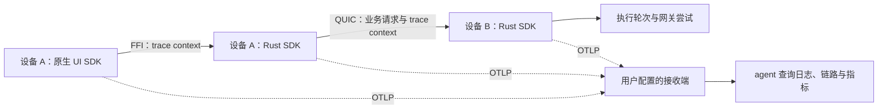

# OTLP 技术方案

状态：方案于 2026-10-26 获用户同意，四端实现已于 2026-10-27 装配并提交；实际通过项和剩余闭环见[验收记录](verification.md)，开发接收端见[部署验证](deployment.md)。用户已同意[产品范围](packet.md)，并进一步确认诊断主要服务于 agent、Velune 定位为分布式架构、各生态优先采用成熟库。本文件收敛实现责任、关联语义和依赖选择，不把源码调查等同于平台联调通过。

## 主要决定

原生层与 Rust 层分别使用本生态 SDK，导出同一客户端的不同观察范围。共享客户端配置、资源身份与标准 trace context，不把原生事件转换成自制 Rust 埋点协议。各设备独立运行、独立决定是否导出；接收端是观察基础设施，不能成为 Velune 执行业务或设备连接的依赖。

修订首轮的两项技术建议：传输统一为 OTLP/gRPC，开发接收端使用固定版本的 `grafana/otel-lgtm` 单容器。Swift 2.6.0 exporter 将 HTTP 标为 experimental、gRPC 标为 production ready；选择 gRPC 避免一端采用实验 exporter 或自建协议桥。Aspire v13.6.4 的机器 API 能查询日志和链路，但指标仍在未来计划内；agent 需要用真实指标判断失败率与延迟，不能拿抽样 trace 替代。LGTM 已装配三种信号的存储与查询接口，运行资源更高，但不需要 Velune 自行维护观测后台。

客户端生产配置仍只认识 OTLP 地址与认证，不依赖 Grafana。首期接收端必须支持 gRPC／HTTP2；只有 OTLP/HTTP 接口的服务需要用户已有的 Collector 转换，产品不暗中转换端口或 URL。

## 数据流与职责

图中相同接收端用于多设备联合调试，不是强制中心。设备可以配置不同目的地；跨目的地关联需要查询对应数据源，不能声称任一后台天然拥有全链路。某端关闭或离线时，其他端继续工作，已观察到的局部链路仍有价值。

| 责任 | 所有者 |
| --- | --- |
| 当前客户端配置、版本、资源身份、Rust SDK 生命周期 | 新增 `packages/telemetry`，不依赖 application 或 remote，不要求 local-runtime |
| 类型化本机设置接口、FFI 上下文接线、客户端装配 | `packages/bindings`；遥测设置不作为远端 `VeluneApplication` 的业务配置 |
| 原生 SDK 与任务／协程／UI 生命周期 | 各平台 app，每个进程一套原生 provider；Rust 同一客户端一套 provider |
| 业务边界、执行状态、耗时及结果 | application、agent-runtime、gateway 等原有 owner；领域模块不创建 exporter |
| 跨设备传播、连接恢复观察与配置分享授权 | remote；移动端同样支持窄配置分享，不需要本地执行 Handler |
| 开发接收端、临时配置、agent 查询入口 | 仓库开发启动工具与开发文档；不加入产品后台服务 |

独立 telemetry package 的理由是多个平台都需要客户端本地设置和 Rust 出口，而移动端不链接完整 application。它不提供一套替代 OTel 的通用 span／log／metric API；领域埋点使用 `tracing` 与 OTel API，协议、采样、批处理和编码交给现成库。

## 库选择

以下组合已核对正式 release／源码，并在隔离程序中完成三信号与关闭队列实验，见[SDK 实验记录](sdk-evidence.md)。实际产品锁文件仍随各平台接入生成；不依赖 main、nightly 或动态 latest。

| 生态 | 选择 | 使用边界 |
| --- | --- | --- |
| Rust | `tracing`、`tracing-subscriber`、`tracing-opentelemetry 0.33.0`；兼容的 `opentelemetry`／`opentelemetry_sdk`／`opentelemetry-otlp`／`opentelemetry-appender-tracing` 0.32 系列 | 复用现有 spans／events，官方 OTLP gRPC exporter；不启用实验 retry 功能 |
| Swift | `opentelemetry-swift-core 2.6.0` 与 `opentelemetry-swift 2.6.0` 的 gRPC exporter，SwiftPM 管理 | 原生任务、界面操作与有限指标；OSLog 继续承担本地系统日志，不抓取整个 OSLog 后上传 |
| Kotlin／Android | OpenTelemetry Java SDK／OTLP exporter／Kotlin context extension，按稳定 BOM 1.62.0 对齐 | 使用协程上下文扩展，手动记录已确定边界；首期不引入 alpha Android RUM Agent 或新的 Kotlin SDK |
| .NET／Windows | `ActivitySource`、`System.Diagnostics.Metrics.Meter`、`ILogger`，配合 OpenTelemetry .NET 和 OTLP exporter1.20.1 | 使用现成 Activity／ExecutionContext 传播，记录 WinUI 操作与跨线程调用 |
| 开发查询 | `grafana/otel-lgtm 0.38.1`（已在 sfp7 联调并固定 digest，见部署记录） | Collector 接入，Tempo 查 trace，Loki 查日志，Prometheus 查指标；不启用 profiling 或 eBPF |

`tracing-opentelemetry 0.33.0` 实际依赖 OTel 0.32，不能与最新 OTel 0.33.1 直接拼装。Rust trace API 仍有 0.x／beta 的稳定性限制，选择已有 tracing 边界隔离版本变动，不自行重写 exporter。

Android 的 1.67.0 Kotlin extension 使用 Kotlin 2.4 metadata，与现有 Kotlin 2.2.21 编译不兼容；计划收敛改为 SDK、exporter、extension 统一 1.62.0，已通过相同编译器的协程与三信号实验，不为遥测扩大 Android 工具链升级范围。

Swift 文档需要区分组件：core 2.6.0 README 标注三种信号 stable，但 exporter 同 tag 仍有旧指标说明及 HTTP experimental 声明。方案仅选择其明确推荐的 gRPC 路线；metrics 使用 core 当前 API，不能根据示例名称误选旧 metrics API。2.6.0 必须为批准的 metric instruments 明确注册 view；隔离实验已经验证实际 wire 数值。稳定性标记与 Mac 实验仍不替代 iOS 真机及系统证书验证。

## 一份本地配置，两套 SDK

每个客户端的私有目录保存一份独立的版本化遥测配置，不并入 `generic-config.json`，避免被远端业务设置或旧配置重置规则影响。文件包括本地修订号、启用偏好、目的地、认证 metadata、采样率。启用偏好区分未设置、明确关闭和明确开启；默认没有配置文件。认证与普通字段原子写入同一私有文件，不让各端另存一份认证。Mac／Unix 使用私有权限，Windows 使用当前用户访问控制；移动端使用应用私有且排除设备备份的目录。

每个进程生成一个 `service.instance.id`，原生与 Rust 共用；平台服务名、应用版本、构建修订和 deployment environment 一致，由 instrumentation scope 区分原生、remote、application、gateway 等来源。安装级关联使用本机随机标识，不使用设备公钥、账户、主机名或设备名称。身份不进入可复制配置。

本机设置接口提供快照、带 expected revision 的保存、关闭、测试、状态与分享用快照。设置摘要只显示认证是否存在；实际认证仅经显式编辑、SDK 装配与获授权的配置分享路径读取。agent 的后端查询凭据与客户端 OTLP 写入凭据分开，配置复制不附带查询或后台管理权限。

生效过程由客户端统一协调：先解析、验证并准备原生／Rust exporter、传输与装配材料；候选阶段不连接事件源、不注册活跃监听器或积攒数据。两侧准备成功且配置原子保存成功后，再撤销旧版本出口，装配并发布新版本。装配或保存失败保留原配置；若切换后发生不可恢复的初始化失败，显示目标配置未生效并停止两侧新导出，不让一侧悄悄沿用旧目的地。两侧报告同一 active revision 后才显示已应用。网络不可达或认证被拒绝属于导出状态，不冒充配置解析失败，也不回退到其他地址。

每代 provider 持有不可变目的地与独立导出许可。关闭、换地址或换认证时，先撤销旧许可并取消／关闭旧传输，再调用 SDK shutdown；不能直接 shutdown，因为 SDK 通常会 flush 队列。旧批次不能转发到新地址或在重新启用后复活。已经开始传输的数据可能在关闭后抵达，无法撤回。只在仍开启的正常退出时做有界 flush；不能在 UI 主线程等待。Swift 多信号共用 channel 时协调 flush 与 channel 关闭，避免第一个 provider 关闭另外两个的传输。

SDK 构造使用显式配置，不引入自动配置器或任意 resource detector。Rust tonic builder 会自动合并环境 headers，因此在 interceptor 中重建批准的 metadata；Swift 显式使用 `envVarHeaders: nil`，所有 resource 使用明确字段。冲突 `OTEL_*` 的合成环境已验证没有覆盖地址／认证；产品装配仍需沿用这些边界。开发入口传入应用专用临时 profile 路径，不把上报凭据放在参数中，也不通过全局 `OTEL_*` 意外开启外部 Harness 的遥测。

稳定的客户端 owner 持有当前代际；长期存活的 ApplicationService、listener 与 reader 持有 owner，在新工作边界读取当前 Dispatch。不能只替换 provider，却让后台线程永久保留已关闭的旧 dispatcher。已有 span 仍归原代际，撤销后允许不完整；新事件与新操作使用新代际并标示关联缺口，不把旧 span 移植到新目的地。FFI 调用视图共享底层 session 关闭状态，仅附加不可变 carrier；显式关闭对所有视图生效。

显式测试操作使用官方生成的 OTLP/gRPC 类型核对回执及 partial rejection，不用 SDK flush 成功代替接收确认；回执成功仍不等同于后台保存与可查询。

## 分布式关联与结果语义

使用官方 W3C Trace Context propagator；FFI 与 remote 协议携带有界的 trace carrier，首期不传播 baggage。trace ID 仅表达观测因果，不能承担设备认证、访问授权、幂等键或业务结果查询键。

| 边界 | 关联方式与约束 |
| --- | --- |
| 原生异步操作 → FFI | 在原生任务中取得当前 context，传入本次调用专属的不可变 application 视图；复用现有类型化方法及底层会话，不修改共享对象的“当前 context” |
| FFI → Rust | 创建 Rust 子 span；同进程上下文不标记为远程。调用视图释放不关闭底层应用，显式 shutdown 仍作用于共享实例 |
| Rust → 工作线程／Tokio task | 沿用 ApplicationService 的 dispatch／span 传递；`spawn_blocking`、reader 线程及 detached task 显式继承，不能依赖线程局部状态跨 await 自行传播 |
| 控制端 → 执行端 QUIC | Submit 携带 context，服务端验证后建立 remote parent 的 server span；鉴权后在受理、排队、执行及响应边界记录阶段 |
| 请求超时 → 重连查询 | 保留原 RequestId，查询是新的 span，关联原请求；“没有收到结果”是 outcome unknown，不自动改成业务失败或重发 |
| 命令受理 → 长时间执行轮次 | 执行 owner 保留独立 work span／关联信息直到终态；控制端离开或连接关闭不结束执行，也不把一次受理的成功当作整轮成功 |
| 执行轮次 → 本机网关 | 从明确的运行实例／活跃轮次绑定传递观察上下文，在请求接纳时捕获；无法唯一证明归属时使用独立 trace 和缺口标记，不凭时间邻近认定父子关系 |
| 网关请求 → 上游尝试 | 每次实际尝试有独立 span；传输完成、模型业务失败、取消、连接断开分别记录。外部服务未提供可用 context 时止于 Velune 可见的调用边界 |

现有网关 `gateway_request` 明确以 `parent: None` 创建，且 runtime reader span 属于长存活 reader；它们都不能直接变成每轮执行的父子链。实施必须将观测关联放在执行 owner 和实际请求接纳处，更新长期存活任务的归属，不能只给当前 span 补一个 trace ID。对于 Velune 管理的 gateway runner，可在轮次进入时绑定 context，轮次结束时清除；后台或并发请求在进入时捕获自己的关联，不后查“当前轮次”拼接历史。

源端关闭时不为遥测开启导出；接收端仍按自身启用状态采集可见部分。有效 parent 的采样标记用于一致的 trace 采样，但不能覆盖本地关闭。没有有效上游 context 时建立本端 root。日志与指标独立于 trace 抽样；日志可带一个尚无可查询 spans 的 trace ID，查询端必须允许这一情况。

连接恢复采用有限时长的连接尝试 spans 与状态事件，包含网络代际、连接代际、重试次数和固定原因分类。业务 span 不挂在几小时的连接 span 下。跨设备使用 parent／link 与请求身份判断因果，不用两台设备的墙钟差计算网络耗时；同进程耗时用单调时钟。

事件名称和字段稳定、可搜索：操作名、阶段、结果类别、错误码、operation ID、remote RequestId、trace ID、span ID。受控失败详情在本地保持完整，不直接放入 OTLP exception.message。版本、角色和协议等有限维度可作为指标标签；请求、会话、设备名称、路径、完整 URL 不能作为指标标签。每个指标只有一个语义 owner：UI 端到端等待、RPC 传输、执行轮次、上游尝试分别计量，不能把两套 SDK 的重复完成事件相加。

现有 remote envelope 拒绝未知字段，不能无版本变更直接加 trace carrier。提案使用下一版 wire protocol，显式报告旧端不兼容，不静默降级权限；保留已有设备身份、联系人与原控制授权，不通过清空配对存储完成升级。具体版本号实施时依据当时主线分配。

## 配置分享

remote 增加与执行权限分离的 `TelemetryProfileRead` 权限和窄配置读取 RPC。旧控制 grant 不自动获得这个权限。已经认识的设备可由来源本地明确授权；未建立信任的设备沿用核对码与限期邀请流程，但邀请与批准内容绑定请求的权限范围，不能在确认后扩大为控制权限。

endpoint 分别维护控制与分享用途的入站许可；任一种用途需要时可接受连接，邀请、配对和具体 RPC 再按用途鉴权。关闭控制不能误关分享，分享开放不能允许业务 Submit。设备存储从现有 v3 显式迁移，保留联系人、原控制 grants、pending RequestId 和 reset notice，新增分享 grants 默认为空；未知未来版本报错而不重置。

移动端在前台使用同一 endpoint 提供该 RPC，不要求 application Handler，也不为后台分享额外保活。读取响应仅在当前授权和加密连接内返回，不进入普通 snapshot、问题详情、通用业务结果账本或持久重试缓存。分享撤销与读取授权检查有明确顺序，撤销阻止随后受理的读取；已发送的配置不能远程收回。

分享内容只有协议版本、目的地、认证及采样策略，不含启用状态、修订号、安装身份或开发覆盖。接收端检查格式与大小后，用本地 expected revision 原子导入，保留自己的开关；导入失败保留旧配置。源设备离线时明确失败，不积压待发送的凭据。回环地址与设备专属认证不自动改写，导入后可测试实际可达性。

## 开发与 agent 使用入口

开发启动工具复用仓库入口，启动或连接本次选定的开发接收端，确认就绪，再生成私有临时 profile 并启动目标客户端。默认使用隔离数据；日常实例只有显式指定才参与。接收端不可用时应用仍能启动，状态明确表示未接入。端口冲突不授权停止其他容器或删除数据；停止操作只清理本次创建的资源。

LGTM 的采集和查询端口默认只绑定开发接收端的回环地址。当前环境选择 sfp7 托管，通过 SSH 将 gRPC 与 Grafana 查询入口转发到开发机；连接已有后台不应每次重建或清空数据。Android 使用 ADB 转发；iOS 模拟器、真机及其他开发设备使用各自验证过的可达地址或受控隧道。需要 LAN 接入时显式选定监听范围与访问条件，不能仅为自动配置而公开默认凭据。普通客户端启动、Debug 构建和环境里出现 OTEL 变量都不构成开启依据。

启动工具输出一个机器可读连接描述：本次 run ID、构建修订、参与客户端、OTLP 入口、各查询入口、私有认证文件位置、保留范围及就绪状态。秘密本身不输出。每个开发操作记录同一 run ID，使 agent 能区分当前复验与旧实例，查询均限定时间、服务／实例和返回条数。

agent 的主入口是现成 HTTP 查询 API：Tempo 按 trace ID／TraceQL 取链路，Loki 按 operation ID／trace ID 查日志，Prometheus 以 PromQL 查询错误数和延迟分布。可使用上游现成 CLI 或 MCP，但首期不再实现一套 Velune 查询协议，也不把 agent 宿主配置改写作为默认安装动作。OTLP 负责写入，不提供跨后台通用查询；生产数据由用户配置的后台及独立查询授权提供访问。

| agent 要回答的问题 | 需要的证据 |
| --- | --- |
| 这次失败发生在哪里？ | 诊断编号关联 UI、FFI、remote、执行和网关 span，固定阶段与结果分类 |
| 修复后是否改善？ | 同一合成负载前后的操作错误计数与延迟分布，按版本／run ID 区分，不能从抽样 trace 估计总量 |
| 为什么没有数据？ | 客户端是否启用、当前配置版本、最后导出结果、丢弃数、接收端就绪与新鲜标记是否能查询 |
| 链路是否完整？ | 哪些客户端参与、采样率、数据保留与查询截断、缺失父 span、未结束 work，以及没有观测权限的外部边界 |
| 远控断线后工作怎样了？ | 原 RequestId 的受理／执行／结果事件和后续查询关联，不以连接状态推测执行状态 |

为了在 exporter 自身失效时仍可诊断，各端在私有目录保留无秘密的结构化遥测状态快照，只在配置或生命周期状态改变时更新，包含进程启动标识与更新时间；它不是新的操作历史库。未运行或过期快照不得被 agent 解读为当前健康。原生崩溃和完整本地错误继续使用各平台现有工具与问题记录，读取真实资料仍服从授权范围。

默认开发 trace 采样率为 100%，便于复现因果；生产只有显式开启后生效，采样率由每端设置。export 队列、单批数量、超时、属性数量与长度都设置有限上限；正常轮询成功不反复产生日志，不逐 token 上报。exporter 内部日志与 HTTP／gRPC 传输日志不重新进入自身 OTLP 管道。关闭、队列满、应用被终止造成的丢弃是可见限制，不能承诺遥测零丢失。

## 过渡与需要验证的边界

现有本地 JSONL、OSLog 与问题详情保留；只给明确审核的事件和字段增加出口。不能以 `target` 以 velune 开头作为允许全部字段外传的充分条件。共享导出配置和 native SDK 加入后，多个 application／remote proxy 复用本地遥测 owner，避免窗口和设备数量放大 exporter 数量。

实施涉及新 telemetry package、bindings API 及 Swift／Kotlin／C#／Python 生成消费方、remote wire 与权限存储、application 工作线程与轮次、agent-runtime、gateway、四端启动／设置／调用包装、开发脚本、依赖锁及许可。既有远控和 Codex 调查工作区修改必须保留并在实施时重新核对，不以本提案中的行号替代当前源码。

技术路线与[实现计划](plan.md)已结合隔离实验收敛。四生态 SDK 三信号、排队数据撤销、新代出口、环境隔离，以及一个真实 Swift／UniFFI 并发传播实验已有证据；Rust 另验证了连接等待期间撤销。它们确定接入路线，不代表产品或全部平台通过。

完整 FFI→QUIC→执行→网关、真实 ApplicationService 不重建的切换、分享权限矩阵、迁移、系统证书、移动端后台及所有关闭竞态，归入相应实现步骤的验收。不能先要求造出整个产品再写计划，也不能因为计划已收敛就跳过这些边界。首期仍不建立托管服务、告警平台、通用自动埋点、profiling、外部 Harness 的完整内部追踪或遥测数据跨设备转发。

## 依据

- 本地源码：[bindings 诊断](../../packages/bindings/src/diagnostics.rs)、[FFI 请求入口](../../packages/bindings/src/lib.rs)、[远控绑定](../../packages/bindings/src/remote.rs)、[工作线程](../../packages/application/src/service.rs)、[remote wire](../../packages/remote/src/protocol.rs)、[网关请求](../../packages/gateway/src/runtime.rs)。
- [Rust tracing bridge 0.33.0 依赖](https://github.com/tokio-rs/tracing-opentelemetry/blob/v0.33.0/Cargo.toml)、[OTLP 0.32 功能](https://github.com/open-telemetry/opentelemetry-rust/blob/opentelemetry-0.32.0/opentelemetry-otlp/Cargo.toml)。
- [Swift core 2.6.0](https://github.com/open-telemetry/opentelemetry-swift-core/blob/2.6.0/README.md)、[Swift exporter 2.6.0](https://github.com/open-telemetry/opentelemetry-swift/blob/2.6.0/README.md)、[Swift gRPC trace exporter](https://github.com/open-telemetry/opentelemetry-swift/blob/2.6.0/Sources/Exporters/OpenTelemetryProtocolGrpc/trace/OtlpTraceExporter.swift)。
- [Java SDK](https://github.com/open-telemetry/opentelemetry-java/tree/v1.62.0)、[Android RUM 当前发布说明](https://github.com/open-telemetry/opentelemetry-android)、[.NET SDK](https://github.com/open-telemetry/opentelemetry-dotnet/tree/core-1.20.1)。
- [Aspire v13.6.4 查询实现](https://github.com/microsoft/aspire/blob/v13.6.4/src/Aspire.Dashboard/Api/TelemetryApiService.cs)、[指标 API 未来计划](https://github.com/microsoft/aspire/blob/main/docs/specs/dashboard-http-api.md#future-considerations)。
- [LGTM 官方开发镜像](https://grafana.com/docs/opentelemetry/docker-lgtm/)、[agent 工具接入资料](https://github.com/grafana/docker-otel-lgtm/blob/main/docs/gcx-integration.md)、[Tempo API](https://grafana.com/docs/tempo/latest/api_docs/)、[Loki API](https://grafana.com/docs/loki/latest/reference/loki-http-api/)、[Prometheus API](https://prometheus.io/docs/prometheus/latest/querying/api/)。
- [OTel SDK shutdown 语义](https://opentelemetry.io/docs/specs/otel/trace/sdk/#shutdown-1)、[环境配置与默认值](https://opentelemetry.io/docs/specs/otel/configuration/sdk-environment-variables/)。
