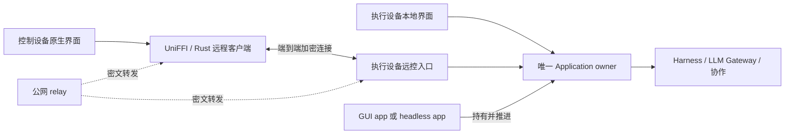

# 远程控制架构讨论稿

2026-10-17。本文保留实施前的方案推导，以下“建议”与待验证项描述当时状态；当前实现契约归 [架构](../../docs/design/architecture.md#远控契约与唯一执行-owner2026-10-17) 及各 unit README，完成状态与证据归 [packet](packet.md) 和 [验收记录](verification.md)。产品承诺以 [PRD](../../docs/prd/index.md#后续扩展分布式能力) 为准。

## 已确认的目标

同一个人的多台设备，通过公网完整使用 Velune，不要求预先配置 VPN 或端口转发。GUI 与 headless 应用都可作为执行宿主，装配同一套共享核心；移动端可以只装配远程客户端，不携带本地 Harness。完整业务能力包括会话、审批、提供商／模型／运行时／资源配置和变更查看；独立终端、通用文件管理与远程桌面不从中自动推出。

## 接入与状态归属

每个执行端由一个应用实例拥有配置、Harness、网关与协作生命周期。本地 UI 和远控请求进入同一串行用例 owner；不能每连接打开一份配置，也不直接绕过 application 调用适配器。GUI 与 headless 只是宿主形态，远控协议不依赖窗口、菜单或本地 UI 是否存在。执行端也可以通过客户端能力连接其它执行设备，不把 Host／Client 固化成硬件类型。

Harness 继续持有原生会话历史；执行设备持有其配置、项目组织、运行状态和待决审批。控制设备持有连接、视图与本地展示偏好。标识在连接边界以执行设备身份限定，不能把不同机器上的相同 runtime ID、conversation ID 或路径混同。远控不隐含跨设备同步工作区、复制认证或转移执行。

## 候选连接与信任机制

建议优先验证 [iroh](https://docs.rs/iroh/latest/iroh/)：用 Rust 原生 QUIC 流承载同一套命令与投影，relay 建连并尝试直连，不分别维护 WebRTC、TURN 和另一套业务 WSS 协议。iroh 提供端到端端点身份与传输，不提供 Velune 的业务授权；端点 ticket 只是拨号信息，不是一次性配对批准。

本人多设备建议显式配对并持久记住设备身份；无需为此引入多人组织、角色或租户系统。执行端对每个请求核对设备授权；撤销同时阻止新连接并取消既有连接的业务访问。已授权设备可以通过显式业务操作查看／修改 API key 和资源内容，但秘密不自动进入设备发现、配置摘要、日志或后台同步。开发验证仅使用合成身份、秘密和会话。

正式可用性需要明确中继运营责任。[iroh 公共 relay](https://docs.iroh.computer/add-a-relay) 定位于开发／测试；自管 relay 与地址发现是独立装配选择。UDP 受限可走 TCP 443 的 WebSocket relay，但完全禁止 WebSocket 的网络仍可能不通，不能声称任意网络保证可达。当前任务不部署服务，也不承诺公共开发设施的生产 SLA。

## 命令、断连和多端语义建议

| 边界 | 建议契约及原因 |
| --- | --- |
| 控制连接与工作寿命 | 用户已确认：连接释放只结束观察与请求等待，不隐式取消 Harness；执行端主动推进事件、发送队列、协作和终态清理；其他已配对设备可接续操作。 |
| 执行宿主退出 | GUI app 和 headless app 都显式管理核心寿命；停止工作沿用现有忙时保护与明确停止动作。机器睡眠、断电、断网属于可达性前提，常驻进程本身不能解决。 |
| 重连投影 | 复用已有 generation／sequence 游标；游标不匹配时取得全量当前投影。待决审批重新读取实际状态，不把历史消息恢复成审批权限。 |
| 副作用请求 | 有请求 ID、接纳结果与结果查询；回执丢失时不能盲目重发发送、编辑、删除或审批。执行端重启且无足够证据时明确结果未知，不承诺跨崩溃 exactly-once。 |
| 同一用户多端写入 | 默认允许已配对设备同时连接，由执行端串行接纳；审批仅首个仍有效的回答生效。配置与编辑操作复核版本，返回冲突，不用一把 Mutex 代替陈旧状态处理。不先引入独占控制租约。 |
| 独立视图 | 当前选中会话、临时筛选与分页需按客户端／视图隔离，不能通过另一设备的浏览动作改变。项目、归档、置顶等业务组织仍归执行端。具体持久浏览偏好的跨端归属待契约收敛。 |
| 路径与附件 | 目标 cwd、配置路径与变更路径属于执行机器。控制设备上传的聊天附件需转换为受控内容／暂存引用；来源图片按内容读取。不能把手机路径送给执行端当成本机文件，也不能为渲染一张图开放任意文件读取。 |
| 完整业务 API | 明确列出具名命令、结果、能力和错误，不把内部任意 JSON action dispatcher 暴露为网络产品接口。不支持的 Harness 原生能力继续明确返回不支持。 |

## Rust package 拓扑建议

新增 `application-api` 与 `remote` 两个有实际消费者的 unit，同时调整现有 `application` 和 `bindings`；不把 protocol、client、server 预拆为三个空壳。

| Unit | 责任与依赖 |
| --- | --- |
| `application-api` | 应用公开输入、结果、错误、配置编辑类型、投影游标与业务命令契约；依赖中立 `conversation`，不依赖 application、gateway 或适配器实现。 |
| `remote` | iroh endpoint、设备身份与授权、请求／回复生命周期、客户端和执行端协议入口；依赖 application-api，不依赖执行实现，通过具名业务处理接口交给 owner。 |
| `application` | 执行本地用例、持有私有配置与适配器、持续推进状态；依赖 application-api，并把远控入口映射到同一本地 owner，不为每个连接新开实例。 |
| `bindings` | 保留具名 UniFFI 业务接口，提供本地／远程装配；只有 local-runtime 产物依赖 application。remote-only 只依赖契约与 remote，不链接 Harness／Node／LLM 执行。 |

这是完整业务 API 和独立远程客户端需要的编译边界。当前 `application --no-default-features` 仍依赖 gateway、ai-provider、HTTP 执行与 SQLite；只把旧 feature 关掉不能证明 remote-only 裁剪完成。`api.rs` 混有公开 DTO、Application 方法和内部转换，提取按公开契约进行，持久配置、执行句柄、认证材料及实现仍留在 application。gateway 的小型配置枚举在应用编辑契约与网关执行边界显式转换；公开模型类型不包含内部 Pi projection。

设备身份、可信设备和连接参数由宿主显式装配；传输库不自行读取全局环境或 Harness 配置。平台是否有 GUI 不影响核心构造和接入方式。

## 实施前需要闭合的证据

传输方向与 package 依赖已经过 advisor 的独立判断，尚未完成 Velune 内的网络或平台编译验证。落地需要证明完整业务契约有唯一归属、执行端复用原 application、remote-only 依赖树中不存在 application／agent-runtime／gateway／ai-provider，并且没有循环依赖。

实现验收应使用合成数据，经真实远控连接覆盖配置、会话、审批和变更查看；断开全部控制端后检查执行推进，再重连恢复投影。另验证未配对拒绝、撤销既有链路、已接纳但丢回执、两端重复审批、陈旧配置修改、不同浏览视图与附件路径边界。执行 fmt/check/clippy 和构建，不新增或运行自动化测试。公网跨 NAT、严格代理和移动生命周期的现场验收与单机隔离证据分开记录。
