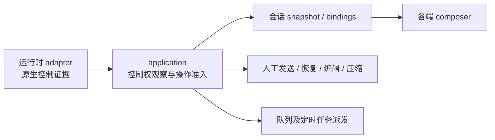

# 会话控制权与本地定时任务方案

状态：用户已明确“按方案继续实现”，以下技术方案与建议默认已获实施授权。双击局部修复已修改、正在原生验收；共享控制权与定时任务按下述顺序推进。

## 已确认目标

- 会话被其他客户端控制时，composer 在发送之前显示锁定并禁用；所有已有适配器按其真实机制接入，后续运行时复用共享契约。
- 双击会话仅重命名，不切换或打开；单击才打开。
- Velune 创建／管理定时任务，并能接管 ChatGPT 已创建的本地任务。退出 Velune 后暂停，重新打开后恢复调度；不增加独立后台宿主。

## 已核实的事实

### 会话控制

本机 Codex CLI 为 0.159.3，Claude Code 为 2.1.292，Pi 为 1.4.0。仅使用公共安装代码和隔离合成数据。

Codex 的排他单位是持久线程的写入者，不是某个 GUI 窗口，也不等于 turn 正在运行。用两个真实 app-server、同一个临时 CODEX_HOME 和合成的已完成历史验证：A resume 后处于空闲但仍持有 writer lock；B 的 thread/read 成功，thread/resume 返回 -32600 和 active writer 冲突；A 退出后 B resume 成功。没有发送模型请求。探针及日志位于 `/tmp/velune-control-investigation/codex_ownership.py`、`ownership.log`。

现有 `activity::SessionStore::is_running` 同时检查 writer lock 和未结束 turn；这个定义可服务运行状态，却无法回答空闲会话能否被本端控制。现有观察也排除了 SSH 与跨 Harness 视图。锁观察的非 Unix 分支直接返回 false，不能用作 Windows 的“可写”证据。

| 运行时 | 已核实的控制机制 | 接入与限制 |
| --- | --- | --- |
| Codex 0.159.3 | thread-writer-locks 下的内核文件锁，随 writer 生命周期持有；只读读取不需要 writer | 与 turn 状态分开观察；识别本 Application 已持有的 writer，不能把自己的空闲 writer 当作外部占用 |
| DSH 0.2.0-rc.2 | JSONL session 的 write handle 持有跨进程租约；POSIX 为 session.lock 的 flock，Windows 为该路径派生的命名 semaphore | 接入同一控制契约，分别实现平台观察；不能只看 lock 文件是否存在，Windows 根本没有该文件 |
| Claude Code 2.1.292 | 已有进程 registry 可证明运行／等待；本机 CLI 的 Session ID already in use 分支检查的是既有 JSONL 文件，不是排他写锁 | 不把这个报错或 registry 的 idle 状态冒充排他控制证据；恢复路径未发现可据以承诺会话排他的契约 |
| Pi 1.4.0 | SessionManager 公开实现未提供对应的跨进程会话写租约 | 保留现有外部执行观察，不捏造控制权；扩展若提供明确协议再接入 |
| ACP v1 | 当前标准类型和本项目握手没有统一会话 ownership 观测 | 能力未报告时保持原行为；未来的版本化扩展或专用 adapter 可贡献明确观测，不在界面猜错误文本 |

[Codex 固定版本 writer 实现](https://github.com/openai/codex/blob/rust-v0.159.3/codex-rs/rollout/src/writer_lock.rs)、[DSH 固定版本租约实现](https://github.com/deepseek-ai/deepseek-harness/blob/dsh-v0.2.0-rc.2/packages/session/session-persistence-jsonl/src/lease.ts)、[DSH Windows 实现](https://github.com/deepseek-ai/deepseek-harness/blob/dsh-v0.2.0-rc.2/packages/session/session-persistence-jsonl/src/win32.ts)。其他运行时的“未发现”是当前证据边界，不是声称永远没有相应机制。

### 定时任务

已安装 ChatGPT.app 的公共 app.asar 中，主进程模块包含 AutomationSchedulerController，宿主存储模块管理 automation.toml、next_run_at、last_run_at、cron／heartbeat；没有读取真实任务定义或数据库。本机 Codex app-server 导出的 198 个方法没有 automation／schedule／cron 管理接口。Plugin 的 scheduled_tasks 是模板声明，不等于 app-server 承担到期派发。

因此在当前支持版本上，Velune 必须承担宿主调度、任务管理、到期派发与结果呈现。app-server 承担被派发后的原生会话和 Agent 执行。官方[本地定时任务说明](https://learn.chatgpt.com/docs/automations?surface=app)也要求电脑开机、桌面应用保持运行。云端 Agents API 的 automations 不是本需求的本地替代。

## 1. 通用控制权与 UX

### 职责与身份

采用独立的控制权观测；不增加 RunState::Locked，也不让界面自行检查 Harness 文件。否则空闲占用会伪装成正在生成，停止、队列、活动统计与后续运行时都要理解同一个错误含义。

- agent-runtime 隐藏每个运行时的路径、协议、平台锁与原生冲突分类，输出版本化的语义观测。
- application 持有观察寿命和准入规则，识别自己的 live handle，生成 UI 的可编辑状态及原因；所有控制端共用同一执行设备的决定。
- 平台仅呈现状态、保留输入和发起重新检查。未来新增运行时只扩展 adapter，普通 composer 与 scheduler 无需品牌分支。
- 身份使用解析后的原生上下文：执行机器／位置、运行时控制命名空间及 HOME、原生会话 ID。runtime instance ID 单独不足以区分物理 writer；同一 HOME 的别名实例也必须识别同一资源。
- 逻辑接续会话以当前上下文的原生段为控制目标，不拿首段来源 ID 代替。过去段只用于读取，不凭其 writer 锁宣称当前叶段被占用。
- 多个 Velune 窗口或控制设备共享同一 ApplicationService 执行 owner；它们不是相互排斥的外部 writer。另一运行时配置所建立的 native handle 仍是另一 Native client；不能为借用控制权而隐式复用其模型、账户、MCP 与审批上下文。

### 状态与界面

内部观测保留 NotReported、Available、OwnedHere、HeldElsewhere、Unknown，附上下文身份、观测时刻和失败类别。Checking 属于观察生命周期。NotReported 表示没有可用的控制契约，不表示已证明“此运行时没有锁”。

核心把观测与现有 run_state／原生只读资格合成为一个类型化的 composer access 投影，客户端不再复制组合规则。

| 情形 | composer | 用户能看到的结果 |
| --- | --- | --- |
| 首次正在检查已支持的控制机制 | 暂时只读，禁止提交 | 正在检查会话控制权 |
| 外部持有，即使没有 turn | 文本与附件只读；发送、排队、steer、继续、压缩和改写原会话不可用 | 锁图标；此会话由其他客户端控制；说明在另一客户端释放后可继续；提供重新检查 |
| 外部正在执行 | 控制权与执行状态分别表达，保留现有外部执行保护 | 不伪造成本端生成，也不给出可停止其他进程的按钮 |
| 本端拥有，或可靠观测未被占用 | 按现有发送／队列资格使用 | 本端生成期间仍可编辑和排队，不因自己持锁而禁用 |
| 检查失败／证据失效 | 明确无法确认，保留只读和重新检查 | 不把 I/O 错误解释为空闲，也不永久显示上一轮“被占用”作为当前事实 |
| adapter 未报告控制契约 | 保留该运行时既有行为 | 不给用户虚假的排他保证，也不因别的 Harness 有锁就锁住它 |

草稿、附件、撤销状态及明确的下一轮选择归属保持；锁定不清空，解锁不自动发送或擅自夺取控制权。只读文本仍可选择和复制；队列移除／取消等待等不写 Harness 的恢复操作继续可用。

### 更新、竞争与失败

- 打开上下文先建立 Checking；控制观测独立于转录文件变化，按需异步检查（当前间隔两秒），刷新沿用同一观察生命周期。检查不发送 prompt、不恢复会话来抢 writer、不修改或删除锁文件。
- 观察在执行机器上进行。SSH 通过执行适配边界返回语义结果，移动端不探测本机路径。慢探测不阻塞 application 对其他会话和取消请求的服务。
- 观察结果绑定上下文身份与配置代际。切换会话、配置、原生段或丢失连接后，迟到结果不能解锁新目标。
- 外部进程退出后原生锁释放，下一次成功检查恢复输入；不以“过了 N 秒”强制认为锁已过期。
- 检查可写不是占有承诺。实际写入仍由 Harness 仲裁；检查后另一个 writer 抢先获得控制时，adapter 将已验证的原生冲突分类为 ControlHeldElsewhere，application 更新投影并保留输入，不把它当普通模型失败或盲目重试。
- 先区分“未接纳”与“接纳结果不明”。后者不能靠再次发送同一输入恢复，也不能伪装成 writer 冲突。
- 发送、恢复、编辑、压缩、队列启动、定时任务派发共用准入。UI 快照不是绕过命令校验的许可证。

## 2. 会话列表双击

采用系统双击判定窗口，单击先选中，待系统双击时限结束再打开；双击取消待打开动作，仅进入重命名。快捷键／方向键导航即时，Option 单击仍在新标签页打开，多选及拖拽不派发延迟打开。

列表选中与已打开的会话是独立事实；普通 snapshot 更新不应把刚选中、正在重命名的另一行覆盖回已打开会话。切换标签／聚焦窗格或视图消失时撤销待打开动作，避免晚到的点击切换错误目标。

代价是鼠标单击打开需要等待一个系统双击判定窗口。这是“双击不先打开”的必要交互取舍；不使用固定毫秒常量，也不重写整个列表。

## 3. Velune 定时任务宿主

### 拥有者与对象

调度器属于执行设备的 application，随 ApplicationService 启停，不属于某个窗口、某个客户端连接或 Codex 专用 adapter。手机／iOS 和远程窗口管理执行设备的任务，不自行再运行一份调度器。复用现有运行时、提供商、网关、权限与会话执行池，不复制 Agent 执行引擎。

- TaskDefinition：名称、指令、显式时区与日历规则、启停状态、修订号；目标用枚举区分每次新建会话与继续现有上下文，不以大量互相矛盾的可空字段表达。
- 新建目标保留运行时实例、模型选择、推理／权限、执行目录及本地／worktree 方式；继续目标绑定稳定会话引用。已有 Harness 原生登录仍归 Harness，任务不复制凭据。
- TaskRun：本次计划触发时间、定义修订、派发身份、会话引用、运行阶段和结果；不复制完整会话正文。计划触发、被接纳与执行完成分别记录。
- 持久定义与运行账本归同一调度存储 owner，事务性领取触发；活动状态不写成第二套 Harness 历史。
- Mac 提供原生“定时任务”窗口：任务列表、启停／立即运行／编辑／删除、下一次执行和运行记录、导入入口；控制端走相同业务接口。Agent 使用 Velune 自己的调度工具，不冒充依赖 ChatGPT 私有宿主的 codex_app 工具。

### 时间、执行与生命周期（建议默认）

- 明确保存时区，不跟随控制设备时区漂移。保留日历 recurrence 语义，使用成熟解析／展开实现；导入时不能把不支持的规则悄悄近似成另一种频率。
- 退出期间暂停；重新打开从下一次未来触发点继续，默认不集中补跑错过的模型请求。界面可显示错过并允许手动运行一次。此为建议默认，不把用户“恢复调度”的原话擅自扩为补跑授权。
- 本次尚未结束时，下一次触发不并发写同一会话；等待会话可用。审批等待保留并通知，不自动批准。外部控制权占用使用同一准入原因等待，释放后只派发一次。
- 领取与派发身份先持久化，再交给执行池。重启后恢复已知会话的观察；崩溃发生在接纳边界、无法判定是否已发送的运行标为结果不明，不能声称任意 Harness 都支持跨崩溃 exactly-once。
- 删除运行时或模型不删除任务指令，也不能让整个配置无法删除；相关任务暂停并要求重新绑定，不擅自改用其他账户或模型。
- 关闭最后一个窗口与退出应用按现有宿主寿命区分。请求退出时停止新接纳；若用户取消退出，调度恢复；确认退出时按既有忙时保护处置正在执行的任务。持久的用户启停状态不因每次退出被重写。
- 不满足条件的 recurrence 必须有计算上界、取消与明确错误；日历展开不在 UI／串行服务主循环中无限寻找下一次。

### 接管已有 ChatGPT 本地任务

接管是调度 owner 转移，不能只复制 ACTIVE 任务并让两个应用同时运行。

1. 用户选择来源和任务。仅读取所需定义、所引用的项目元数据及运行状态；不扫描认证或会话正文。按源版本解析 cron 与 heartbeat，预览规则／时区、目标、原启停状态、模型、目录、工作树和通知方式。
2. 映射到 Velune 的运行时、项目与模型身份。裸 model 名称不是 Velune 提供商身份；无法对应的条目保持待配置，明确说明，不猜测账户。
3. 以来源身份和指纹幂等导入，先保存为暂停；再次导入显示差异并更新原导入项，不新建重复计划。
4. 通过有证据的原宿主管理入口停用来源并确认；入口不可用时引导用户在 ChatGPT 中暂停后重新检查。单改一个 TOML 文件不能未经验证就宣称源进程已停止派发，也不能取消已接纳的旧运行。
5. 来源确认停用、相关在途运行已处理后，再由用户激活 Velune 计划。中途失败保留可恢复的交接状态，不能两边都处于 ACTIVE。
6. 保留来源关联用于后续检查；发现来源被重新启用或发生冲突修改时，暂停 Velune 这一份并要求处理，不偷偷抢回原应用的设置。

当前公开资料没有两应用共用的原子调度租约，因此不承诺在原应用被用户重新启用、或来源管理入口不可验证时仍能无条件一键接管。先完成安全的暂停导入，比把文件复制称为接管更符合本目标。

## 验收与实施顺序

| 增量 | 必须看到的反例与结果 |
| --- | --- |
| 原生证据与共享控制契约 | Codex 空闲持锁；DSH write handle；残留未持有文件；自身 writer；另一个 HOME 的同 ID；未知错误；Mac／Windows／SSH 的证据边界 |
| application 准入和投影 | 首次打开无可提交闪烁；没有转录改动也能锁／解锁；旧检查结果不能覆盖新上下文；检查后竞争由原生错误归类；跨 Harness 当前段及远控同一结果 |
| composer 各端消费 | 锁定的文本、附件和提交；可复制且草稿保留；快捷键／命令面板／sheet／独立停靠与浮动输入区同样受保护；解锁不自动发送 |
| 列表修复 | 双击未打开的 B：重命名出现而 A 仍打开；取消后仍不切换；单击 B 只打开一次；键盘即时；多选、拖拽和 Option 保留；等待期间切换窗格不晚到打开 |
| 调度存储与执行 | 受控时钟覆盖启停、退出重开、跨午夜／时区／DST、无解规则、忙时和外部占用、审批、崩溃接纳边界、运行时删除、多客户端同时编辑与同一触发去重 |
| 导入与任务窗口 | 合成 cron／heartbeat；源运行中、停用失败、来源变更、重复导入、缺失模型／项目、源被重启用；确认无双端激活；不操作真实任务作开发验收 |

建议先完成控制权与准入，再接入调度器，避免为人工发送和后台任务分别实现冲突处理。列表修复可独立交付。进入实现时把已接受的契约收敛到 PRD／Product TDD；当前技术候选只在本任务包维护。
